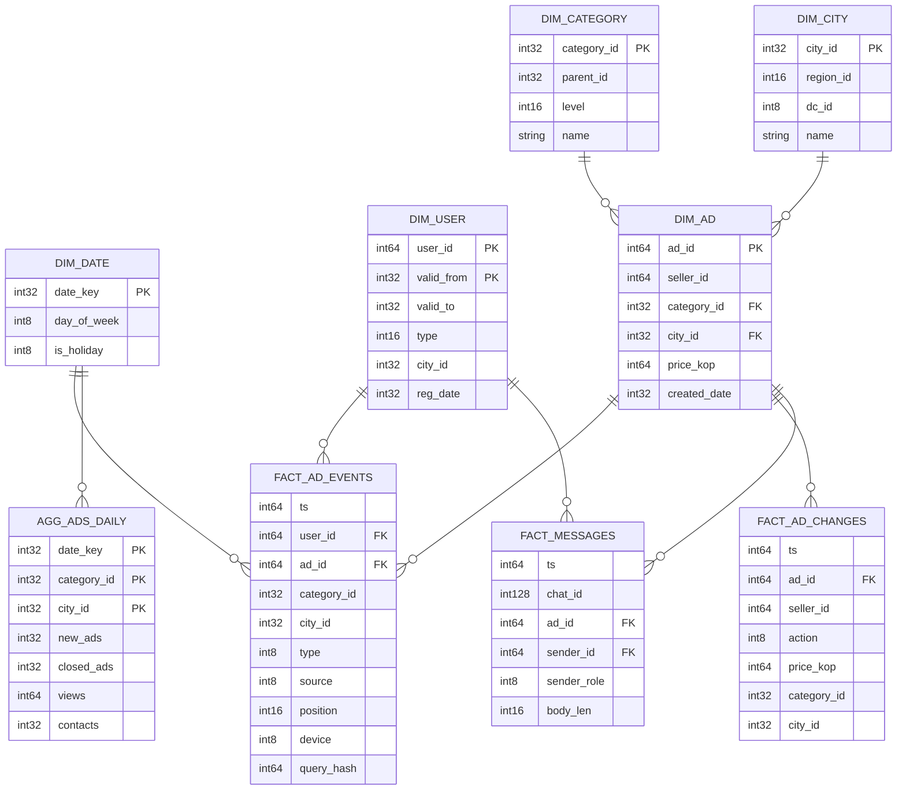
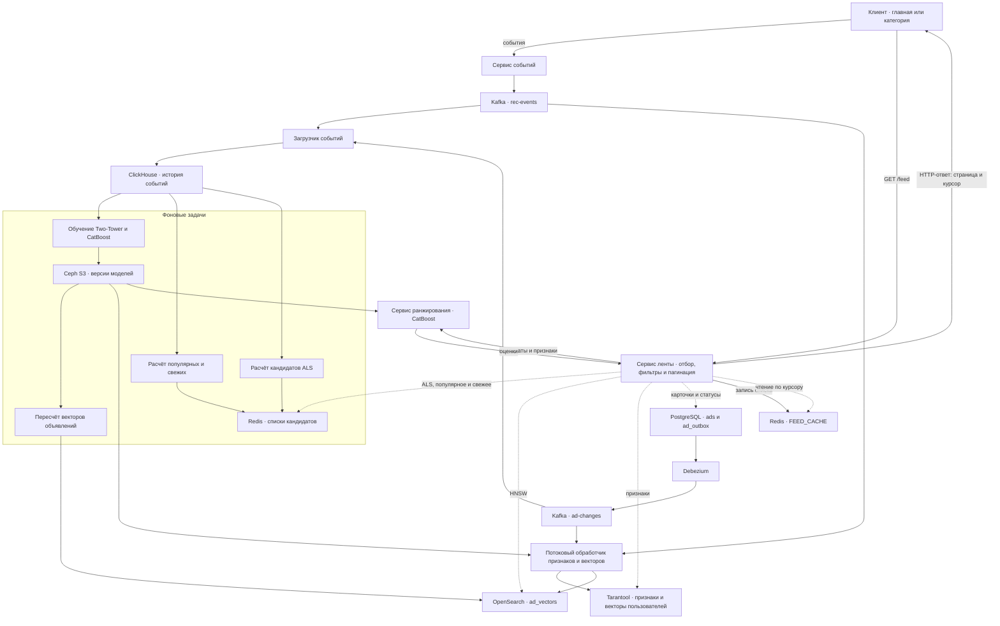
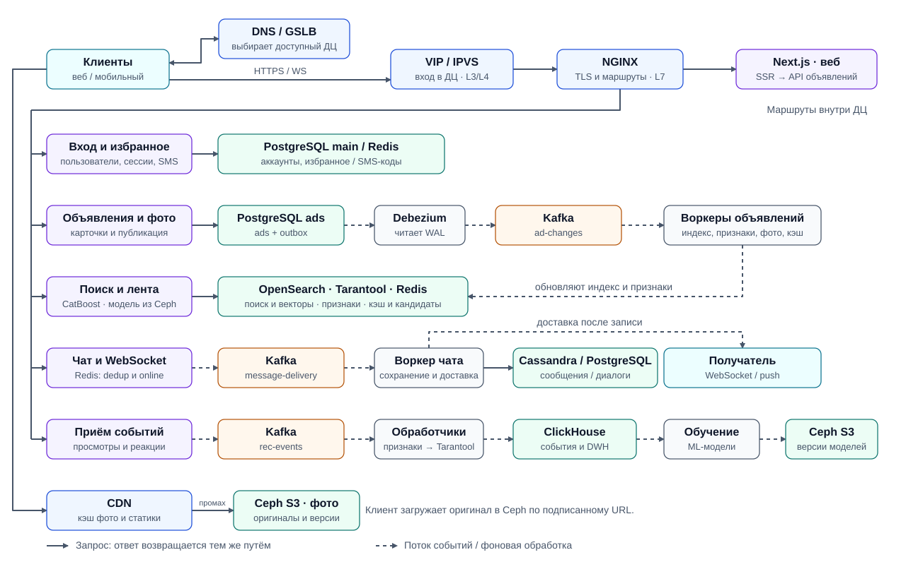

# Расчётно-пояснительная записка

**Дисциплина:** Проектирование высоконагруженных систем  
**Тема проекта:** Проектирование высоконагруженного сервиса онлайн-объявлений на примере «Авито»

## 1. Тема и целевая аудитория

### 1.1. Тема проекта, рыночная ниша и аналоги

Проектируется сервис онлайн-объявлений, в котором пользователи размещают предложения о продаже товаров, находят подходящие объявления и связываются с продавцами. Основной реальный аналог — **«Авито»**. Сервис поддерживает взаимодействие частных лиц между собой (C2C) и продажи от предпринимателей конечным покупателям (B2C).

Рыночная ниша - покупка и продажа новых и подержанных товаров через интернет. Покупатели сравнивают предложения по цене и местоположению, а продавцы получают доступ к массовой аудитории. Дополнительный аналог — платформы группы OLX, объединяющие частных пользователей и бизнес [2](https://www.olxgroup.com/about-us/).

В работе рассматривается основной пользовательский контур: объявления, поиск, рекомендательная лента, избранное и переписка. Большой каталог, хранение изображений, персонализация выдачи и обмен сообщениями делают архитектуру достаточно сложной для проектирования высоконагруженной системы.

### 1.2. Целевая аудитория: размер и локализация

Основной рынок — **Россия**. Целевая аудитория — частные покупатели и продавцы, предприниматели и небольшие магазины. Доступ осуществляется через сайт и мобильные приложения. Один пользователь может одновременно выступать покупателем и продавцом.

| Показатель | Значение | Основание |
| --- | --- | --- |
| Месячная аудитория реального аналога | **114 млн пользователей** | Внутренние данные AvitoTech [1](https://avito.tech/) |
| Активные объявления реального аналога | **220 млн** | Внутренние данные AvitoTech [1](https://avito.tech/) |
| MAU проекта | **114 млн** | Принятый масштаб на основе данных аналога |
| Средняя DAU проекта | **22,8 млн** | Расчётное допущение: 6 активных дней на пользователя за 30 дней |

DAU рассчитывается как **114 × 6 / 30 = 22,8 млн**. Это проектное допущение, а не опубликованная статистика «Авито». Полученное значение превышает требуемый минимум в 1 млн пользователей в день [3](https://github.com/init/highload/blob/main/homework_architecture.md).

### 1.3. Функционал MVP

Выделены **6 ключевых функций**:

1. **Регистрация и авторизация.** Создание аккаунта по номеру телефона, подтверждение входа и управление пользовательской сессией.
2. **Управление объявлениями.** Создание, редактирование и снятие с публикации, включая загрузку фотографий и подготовку уменьшенных версий. Объявление содержит название, описание, цену, категорию и город.
3. **Поиск и фильтрация.** Поиск по тексту, категории, цене и местоположению, сортировка, постраничная выдача и открытие карточки объявления.
4. **Рекомендательная лента.** Персональный подбор объявлений на главной странице по истории поиска, просмотрам, избранному и обращениям к продавцам с учётом местоположения пользователя.
5. **Избранное.** Сохранение объявлений в личный список и доступ к нему с разных устройств.
6. **Чат покупателя и продавца.** Обмен текстовыми сообщениями по объявлению, список диалогов, история переписки и отметки о прочтении.

Оплата, доставка, бронирование, платное продвижение, отзывы и видеоконтент в MVP не входят.

### 1.4. Ключевые продуктовые решения

- **Просмотр без входа.** Поиск и объявления доступны всем; публикация, избранное и чат требуют авторизации.
- **Асинхронное обновление поиска.** В выдачу попадают активные объявления, прошедшие базовую проверку. Изменения могут появляться с небольшой задержкой; при открытии карточки проверяется текущий статус.
- **Персонализация рекомендаций.** Сначала отбираются объявления-кандидаты по интересам и региону, затем модель ранжирует их по вероятности обращения к продавцу. События поведения обрабатываются асинхронно. Пользователям без истории и при недоступности рекомендаций показываются популярные и свежие объявления региона. Снятые объявления исключаются из выдачи.
- **Отдельное хранение фотографий.** База содержит метаданные изображений, а сами файлы размещаются в объектном хранилище.
- **Серверная история переписки.** Сообщения сохраняются при смене устройства. Повторная отправка запроса с тем же идентификатором не создаёт дубликат сообщения.

## 2. Расчёт нагрузки

### 2.1. Исходные продуктовые метрики

Масштаб аудитории и каталога взят из внутренних данных AvitoTech [1](https://avito.tech/), повторно проверенных 16.09.2026. Данные Similarweb не используются. **Частота действий, размеры объектов, сроки хранения и коэффициенты ниже — проектные допущения, а не статистика Авито.**

| Показатель | Значение | Основание |
| --- | --- | --- |
| MAU | 114 млн | Принятый в разделе 1 масштаб аналога [1](https://avito.tech/) |
| Средняя DAU | 22,8 млн | 114 млн × 6 активных дней / 30 дней |
| Хранимые аккаунты | 150 млн | Допущение, включая неактивные; число аккаунтов не равно MAU |
| Активные объявления | 220 млн | Масштаб каталога аналога [1](https://avito.tech/) |
| Создание объявлений | 0,05 на пользователя DAU в день | Например, одно новое объявление у 5% дневной аудитории |
| Фотографии в объявлении | В среднем 5 | Оригинал 2 МБ, версия для карточки 200 КБ, миниатюра 20 КБ |
| Выдача поиска / ленты | 20 карточек на страницу | В среднем загружаются 10 миниатюр; остальные — при прокрутке |
| Просмотр карточки | В среднем 3 фотографии | Передаётся версия 200 КБ, а не оригинал |
| Избранное | В среднем 10 записей на аккаунт | Одна загрузка списка передаёт 10 миниатюр |
| Снятые объявления и их фото | Хранятся 30 дней | Для модели принимается стабильный размер активного каталога |
| История чатов | Расчёт за 365 дней | При более долгом хранении объём растёт пропорционально сроку |
| События рекомендаций | 120 на пользователя DAU в день; хранение 30 дней | Около 100 показов и 20 других взаимодействий, включая поиск, просмотры и избранное |
| Коэффициент пика | **4** | Пиковый минутный RPS равен четырём среднесуточным; допущение для вечернего пика |

Все величины десятичные: **1 КБ = 1 000 Б; 1 ГБ = 10⁹ Б; 1 ТБ = 10¹² Б**. Дробные действия — среднее по всей DAU, включая пользователей, которые это действие не выполняют.

### 2.2. Действия пользователей и RPS

Одна загрузка страницы считается одним запросом. Фотографии и события аналитики учитываются отдельно. Адреса методов условные и описывают проектируемый API.

$$
N_i = DAU \times a_i,\qquad
RPS_{avg,i} = \frac{N_i}{86\,400},\qquad
RPS_{peak,i} = 4 \times RPS_{avg,i}.
$$

Например, поиск: **22,8 млн × 5 / 86 400 ≈ 1 319 запросов/с**, пик — **5 278 запросов/с**.

| Действие | Метод | На пользователя DAU в день | Млн запросов/сутки | Средний RPS | Пиковый RPS |
| --- | --- | ---: | ---: | ---: | ---: |
| SMS-код | `POST /auth/code` | 0,01 | 0,228 | 2,6 | 10,6 |
| Вход / регистрация | `POST /auth/verify` | 0,01 | 0,228 | 2,6 | 10,6 |
| Обновление сессии | `POST /auth/refresh` | 0,2 | 4,56 | 52,8 | 211,1 |
| Создание объявления | `POST /ads` | 0,05 | 1,14 | 13,2 | 52,8 |
| Редактирование / снятие | `PATCH /ads/{id}` | 0,1 | 2,28 | 26,4 | 105,6 |
| Поиск | `GET /search` | 5 | 114 | 1 319,4 | 5 277,8 |
| Рекомендательная лента | `GET /feed` | 5 | 114 | 1 319,4 | 5 277,8 |
| Карточка объявления | `GET /ads/{id}` | 10 | 228 | 2 638,9 | 10 555,6 |
| Список избранного | `GET /favorites` | 1 | 22,8 | 263,9 | 1 055,6 |
| Добавление в избранное | `PUT /favorites/{id}` | 0,25 | 5,7 | 66 | 263,9 |
| Удаление из избранного | `DELETE /favorites/{id}` | 0,25 | 5,7 | 66 | 263,9 |
| Создание диалога | `POST /chats` | 0,1 | 2,28 | 26,4 | 105,6 |
| Список диалогов | `GET /chats` | 1 | 22,8 | 263,9 | 1 055,6 |
| История сообщений | `GET /chats/{id}/messages` | 2 | 45,6 | 527,8 | 2 111,1 |
| Отправка сообщения | `POST /chats/{id}/messages` | 2 | 45,6 | 527,8 | 2 111,1 |
| Отметка о прочтении | `POST /chats/{id}/read` | 1 | 22,8 | 263,9 | 1 055,6 |
| События рекомендаций | `POST /events/batch` | 6 | 136,8 | 1 583,3 | 6 333,3 |
| **Итого API** | — | **33,97** | **774,516** | **8 964,3** | **35 857,2** |

В `PATCH /ads/{id}` заложены 0,05 редактирования текста/цены и 0,05 снятия с публикации на пользователя в день. Загрузка фото входит в создание объявления, но создаёт отдельные сетевые запросы:

| Действие | Метод | На пользователя DAU в день | Млн запросов/сутки | Средний RPS | Пиковый RPS |
| --- | --- | ---: | ---: | ---: | ---: |
| Загрузка фото | `PUT /media/{id}` | 0,25 | 5,7 | 66 | 263,9 |
| Миниатюры | `GET /media/{id}/thumb` | 110 | 2 508 | 29 027,8 | 116 111,1 |
| Фото в карточках | `GET /media/{id}/display` | 30 | 684 | 7 916,7 | 31 666,7 |
| **Итого изображения** | — | **140,25** | **3 197,7** | **37 010,4** | **148 041,7** |

Число загрузок фото: **0,05 × 5 = 0,25** на пользователя в день. Миниатюры: **(5 страниц поиска + 5 страниц ленты) × 10 + 10 из избранного = 110**. Крупные фото: **10 карточек × 3 = 30**. Это сетевые загрузки; эффект браузерного кэша для консервативной оценки не вычитается.

Совокупный внешний HTTP-пик — **183 899 запросов/с**, включая выдачу изображений через CDN. Это не RPS одного сервера или базы данных. Итоги рассчитаны до округления строк.

Для рекомендаций 120 событий передаются в среднем по 20 в пакете: **6 HTTP-запросов на пользователя в день**. Внутренняя обработка составляет **31 667 событий/с в среднем и 126 667 в пике**. Это события, а не дополнительные внешние запросы. При 500 кандидатах на запрос ленты верхняя оценка без кэширования — **2,64 млн оценок кандидатов/с**; стоимость одной оценки потребуется измерить при выборе модели.

### 2.3. Общий объём хранения

В сутки создаётся **22,8 млн × 0,05 = 1,14 млн объявлений**. При стабильном каталоге столько же снимается с публикации. Архив за 30 дней: **34,2 млн**; всего хранится **220 + 34,2 = 254,2 млн объявлений** и **1,271 млрд фотографий**. Это соответствует среднему активному сроку объявления около **193 дней**; допущение включает длительно размещённые предложения.

Формула: **V = количество объектов × средний размер объекта**. Для сообщений: **22,8 млн × 2 × 365 × 1 КБ = 16,644 ТБ**.

| Тип данных | Количество, млн шт. | Размер объекта | Объём, ТБ |
| --- | ---: | ---: | ---: |
| Профили и настройки | 150 | 2 КБ | 0,3 |
| Объявления и метаданные фото | 254,2 | 4 КБ | 1,017 |
| Оригиналы фото | 1 271 | 2 МБ | 2 542 |
| Фото для карточек | 1 271 | 200 КБ | 254,2 |
| Миниатюры | 1 271 | 20 КБ | 25,42 |
| Избранное | 1 500 | 32 Б | 0,048 |
| Сообщения | 16 644 | 1 КБ | 16,644 |
| Диалоги с участниками, 365 дней | 832,2 | 512 Б | 0,426 |
| **Итого** | — | — | **2 818,148** |

Размер объявления 4 КБ включает текст, атрибуты и метаданные фотографий; сами фото посчитаны отдельно. Сессии — две на пользователя MAU. Диалог 512 Б включает участников и служебные поля. Признаки — компактные данные для ранжирования. Кэш ленты содержит до 100 пар «объявление — оценка» по 16 Б для каждого пользователя DAU; хранение до суток. Поисковый индекс оценён отдельно по 6 КБ на активное объявление.

Это **одна копия данных**, без репликации, резервных копий и временных буферов. Для обычных записей также не включены накладные расходы СУБД и вторичные индексы. Физическую ёмкость уточняем при выборе хранилищ. На фотографии приходится **2 821,62 ТБ — около 98,7%** рассчитанного объёма.

Новые фото с производными версиями создают **12 654 ГБ записей в сутки**. В стабильном режиме столько же освобождается при удалении старого архива. Сообщения добавляют **45,6 ГБ/сутки**, события рекомендаций — **547,2 ГБ/сутки** с удалением записей старше 30 дней. Это запись в хранилища, а не повторно прибавляемый клиентский трафик.

### 2.4. Сетевой трафик

Размеры прикладных ответов: поиск, лента и история чата — **20 КБ**; избранное и список диалогов — **10 КБ**; карточка — **5 КБ**; вход и создание объявления — **2 КБ**; приём событий — **0,5 КБ**; остальные — **1 КБ**. Изображения в JSON не включаются.

На запрос закладывается **0,5 КБ**, кроме создания объявления (**3 КБ**), редактирования и отправки сообщения (**1 КБ**), пакета событий (**20 × 200 Б = 4 КБ**). Дополнительно учитывается одна онлайн-доставка получателю по **1 КБ** на отправленное сообщение. Получение истории уже включено в ответы API.

$$
V_{day,i}\,[ГБ] = \frac{N_i \times S_i\,[Б]}{10^9},\qquad
B_{peak,i}\,[Гбит/с] = \frac{V_{day,i}\,[ГБ] \times 8 \times 4}{86\,400}.
$$

| Тип трафика | Направление относительно сервиса | ГБ/сутки | Пик, Гбит/с |
| --- | --- | ---: | ---: |
| API: входящие запросы | Входящий | 892,85 | 0,331 |
| API: ответы | Исходящий | 7 228,28 | 2,677 |
| Фото: загрузка | Входящий | 11 400 | 4,222 |
| Миниатюры: выдача | Исходящий | 50 160 | 18,578 |
| Фото: выдача | Исходящий | 136 800 | 50,667 |
| Онлайн-доставка сообщений | Исходящий | 45,6 | 0,017 |
| **Всего входящий** | Клиент → сервис | **12 292,848** | **4,553** |
| **Всего исходящий** | Сервис → клиент | **194 233,884** | **71,938** |

Например, выдача крупных фото: **22,8 млн × 30 × 200 КБ = 136 800 ГБ/сутки**, пик — **50,667 Гбит/с**.

С **20% запасом** на транспортные накладные расходы и дополнительные передачи необходимая совокупная внешняя пропускная способность составляет **5,46 Гбит/с на вход и 86,33 Гбит/с на выход**. Направления считаются раздельно: это нагрузка всей системы, а не отдельного сетевого интерфейса.

При проектном допущении **90% попаданий в CDN-кэш** до основного хранилища доходит 10% чтений изображений. Для модели доля одинакова у обоих размеров фото, поэтому уменьшаются и запросы, и байты. С учётом API и доставки сообщений исходящий пик основных серверов составит **9,62 Гбит/с**, с запасом — **11,54 Гбит/с**. Это часть уже рассчитанного трафика, её не нужно прибавлять к нему второй раз. Межсерверный обмен и репликация оцениваются после выбора архитектуры.

Если частота активности составит 3–9 дней в месяц вместо 6, DAU изменится до **11,4–34,2 млн**, а запросы и клиентский трафик — до **0,5–1,5 базовой оценки**. Объём существующего каталога при этом не меняется автоматически; архив, сообщения и события пересчитываются по своим потокам и срокам хранения.

### 2.6. Рост нагрузки и ёмкости со временем

Для capacity planning введём отдельное **проектное допущение**: MAU и активный каталог растут на **10% в год**, а поведение одного пользователя, коэффициент пика и сроки хранения остаются неизменными. Это не прогноз для «Авито», а сценарий, позволяющий оценить запас инфраструктуры.

Для метрики, пропорциональной размеру аудитории или каталога:

$$
M(t) = M_0 \times (1 + g)^t,\qquad g = 0{,}10.
$$

При таких условиях RPS и сетевой трафик растут с тем же коэффициентом. Данные со скользящим TTL не накапливаются бесконечно: их объём после заполнения окна растёт главным образом вместе с DAU и каталогом.

| Горизонт | Коэффициент к текущей нагрузке | MAU, млн | DAU, млн | Пиковый API RPS | Совокупный внешний HTTP-пик, RPS | Хранилище, ТБ | Исходящий пик, Гбит/с | Исходящий пик +20%, Гбит/с |
| --- | ---: | ---: | ---: | ---: | ---: | ---: | ---: | ---: |
| Сейчас | 1,000 | 114,0 | 22,8 | 35 857 | 183 899 | 2 856,7 | 71,94 | 86,33 |
| Через 1 год | 1,100 | 125,4 | 25,08 | 39 443 | 202 289 | 3 142,3 | 79,13 | 94,96 |
| Через 2 года | 1,210 | 137,94 | 27,59 | 43 387 | 222 518 | 3 456,6 | 87,05 | 104,46 |
| Через 3 года | 1,331 | 151,73 | 30,35 | 47 726 | 244 769 | 3 802,2 | 95,75 | 114,91 |

Если реальный темп роста отличается от 10%, таблица пересчитывается заменой коэффициента `g`. Для архитектурного проектирования важен именно такой сценарный расчёт: он показывает, когда текущего запаса по RPS, сети и хранилищу перестанет хватать.

## 3. Глобальная балансировка нагрузки

### 3.1. Функциональное разбиение по доменам

Разные типы трафика имеют разные требования к кэшированию, состоянию соединений и отказоустойчивости, поэтому внешний трафик целесообразно разделить по поддоменам.

| Домен | Назначение | Основной тип нагрузки | Особенности балансировки |
| --- | --- | --- | --- |
| `www.service.ru` | Веб-клиент и статические ресурсы | Статика | CDN, агрессивное кэширование |
| `api.service.ru` | Авторизация, объявления, поиск, лента, избранное | Короткие HTTP-запросы | GSLB между ДЦ + локальный L7-балансировщик |
| `chat.service.ru` | Диалоги, сообщения, WebSocket | HTTP + долгоживущие соединения | Выбор ближайшего здорового ДЦ, соединение закрепляется до разрыва |
| `events.service.ru` | Пакетные события рекомендаций | Write-heavy HTTP | Можно сильнее перераспределять между ДЦ, так как обработка асинхронная |
| `media.service.ru` | Загрузка и выдача фотографий | Большой объём байтов и высокий RPS | CDN/Anycast; к origin идут загрузки и cache miss |

`www.service.ru` отдельно в расчёте RPS из раздела 2 не оценивался, поэтому для него не добавляется искусственная численная нагрузка. Основной динамический API из раздела 2 распределяется между `api`, `chat` и `events`, а изображения — через `media`.

### 3.2. Расположение дата-центров

Для проекта принимаются три независимых ДЦ:

1. **Москва** — основной ДЦ для западной части России и крупнейшей доли аудитории.
2. **Екатеринбург** — промежуточная точка для Поволжья и Урала, уменьшающая расстояние до центрального ДЦ для пользователей восточнее европейской части.
3. **Новосибирск** — ДЦ для Сибири и как ближайший из трёх регионов для значительной части трафика с востока страны.

Росстат публикует распределение населения по федеральным округам и субъектам [4]. Однако открытой статистики именно по географическому распределению трафика проектируемого сервиса в исходных данных нет, поэтому **не следует выдавать долю населения за долю запросов**. Для расчёта принимается явное проектное распределение трафика:

- Москва — **55%**;
- Екатеринбург — **25%**;
- Новосибирск — **20%**.

В production эти веса должны корректироваться по реальным данным о пользователях, сетевой задержке и загрузке ДЦ. Latency-based DNS routing позволяет направлять пользователя в регион с меньшей наблюдаемой задержкой, а health checks исключают недоступный endpoint [5].

Влияние размещения ДЦ на продуктовые метрики оценивается через технические показатели, которые напрямую измеряются в эксплуатации:

| Архитектурное решение | Измеряемая техническая метрика | Ожидаемое влияние на продукт |
| --- | --- | --- |
| Ближайший ДЦ для API | p50/p95 latency, TTFB | Более быстрые поиск, карточка и лента |
| Локальный вход для чатов | Время установки/восстановления соединения | Меньше задержка отправки сообщений и reconnect |
| CDN перед `media.service.ru` | Cache hit ratio, latency выдачи фото | Быстрее загрузка карточек и ленты |
| Несколько независимых ДЦ | Availability, error rate | Меньше недоступность сервиса при отказе региона |

Конкретный рост конверсии или retention без A/B-теста не задаётся: в работе фиксируется технический эффект, а не придумывается продуктовый uplift.

### 3.3. Распределение запросов по дата-центрам

В нормальном режиме для расчёта используются веса **55/25/20**. Для каждого типа запросов:

$$
RPS_{dc,i}=RPS_{peak,i}\times w_{dc}.
$$

Типы API объединены по функциональным группам; суммы получены из таблицы 2.2 до округления отдельных строк.

| Тип запросов | Общий пиковый RPS | Москва, 55% | Екатеринбург, 25% | Новосибирск, 20% |
| --- | ---: | ---: | ---: | ---: |
| Авторизация | 232,2 | 127,7 | 58,1 | 46,4 |
| Объявления и карточки | 10 713,9 | 5 892,6 | 2 678,5 | 2 142,8 |
| Поиск | 5 277,8 | 2 902,8 | 1 319,4 | 1 055,6 |
| Рекомендательная лента | 5 277,8 | 2 902,8 | 1 319,4 | 1 055,6 |
| Избранное | 1 583,3 | 870,8 | 395,8 | 316,7 |
| Чаты | 6 438,9 | 3 541,4 | 1 609,7 | 1 287,8 |
| События рекомендаций | 6 333,3 | 3 483,3 | 1 583,3 | 1 266,7 |
| **Итого API** | **35 857,2** | **19 721,5** | **8 964,3** | **7 171,4** |

Изображения нужно считать отдельно. Из **148 041,7 RPS** медиатрафика **263,9 RPS** приходится на загрузку фотографий, а **147 777,8 RPS** — на чтение миниатюр и фотографий. При принятом ранее cache hit ratio **90%** до origin доходит только 10% чтений:

$$
147\,777{,}8 \times 0{,}1 = 14\,777{,}8\ RPS.
$$

| Медиатрафик | Общий пиковый RPS | Москва, 55% | Екатеринбург, 25% | Новосибирск, 20% |
| --- | ---: | ---: | ---: | ---: |
| Загрузка фото в origin | 263,9 | 145,1 | 66,0 | 52,8 |
| Чтение изображений пользователями | 147 777,8 | 81 277,8 | 36 944,4 | 29 555,6 |
| Из них cache miss до origin, 10% | 14 777,8 | 8 127,8 | 3 694,4 | 2 955,6 |

Строка «чтение изображений пользователями» характеризует внешний трафик CDN и **не должна прибавляться** к нагрузке application-ДЦ. Пиковая нагрузка на origin в нормальном режиме составляет примерно:

$$
35\,857{,}2 + 263{,}9 + 14\,777{,}8 = 50\,898{,}9\ RPS.
$$

Из неё примерно **27 994 RPS** приходится на Москву, **12 725 RPS** на Екатеринбург и **10 180 RPS** на Новосибирск.

### 3.4. DNS-балансировка

Для динамических доменов используется DNS-GSLB с небольшим TTL и health checks. При здоровых ДЦ DNS выбирает endpoint по задержке/географии с целевыми весами 55/25/20. Если endpoint становится unhealthy, он исключается из ответов DNS. В документации Route 53 для latency records с health checks рекомендуется TTL 60 секунд или меньше, чтобы клиенты быстрее реагировали на изменение состояния [8].

```text
                         DNS GSLB
                    api.service.ru
                          |
            +-------------+-------------+
            |             |             |
      health/latency health/latency health/latency
            |             |             |
      VIP Москва      VIP Екатеринбург  VIP Новосибирск
          55%              25%              20%
            |               |                |
        Local L7 LB     Local L7 LB      Local L7 LB
            |               |                |
         API pool         API pool          API pool
```

DNS хорошо подходит для выбора региона, но failover не является мгновенным из-за TTL и кэшей резолверов. Поэтому быстрый входной failover и раздачу медиа целесообразно дополнять Anycast.

### 3.5. Anycast-балансировка

Для `media.service.ru` и внешнего edge-слоя используется единый Anycast IP. Один и тот же IP анонсируется из нескольких точек сети; BGP приводит пользователя к топологически ближайшему доступному edge. Такой подход типичен для CDN и глобальных edge-сетей [6].

```text
                         media.service.ru
                         Anycast IP
                              |
               +--------------+--------------+
               |              |              |
          Edge/PoP West   Edge/PoP Ural   Edge/PoP East
               |              |              |
          CDN cache       CDN cache       CDN cache
               | miss         | miss         | miss
               +--------------+--------------+
                              |
                     Regional origin layer
                 MSK 55% / EKB 25% / NSK 20%
```

При попадании в CDN-кэш запрос завершается на edge. Только cache miss идёт к origin. Поэтому Anycast снимает основную нагрузку с каналов между пользователями и ДЦ и уменьшает расстояние до точки выдачи фотографий.

### 3.6. Механизм регулировки трафика между ДЦ

Регулировка состоит из трёх уровней:

1. **Health checks.** Периодические проверки `/healthz` и ключевых зависимостей. Нездоровый ДЦ получает вес 0 и перестаёт принимать новый трафик. Health checks и автоматический failover являются стандартным механизмом глобальных балансировщиков [7].
2. **Latency/geo steering.** В штатном режиме пользователь направляется в ближайший здоровый ДЦ, но целевые веса ограничивают перекос нагрузки.
3. **Load-aware weights.** При приближении ДЦ к лимиту по RPS, CPU или latency его вес уменьшается постепенно, а новый трафик переносится в другие регионы. Для проектной модели порог начала разгрузки принимается на уровне около **80% выделенной ёмкости**.

Чтобы пережить отказ одного ДЦ, недостаточно распределить только текущую нагрузку: необходим резерв мощности. При origin-пике **50 898,9 RPS** предлагается capacity-план:

| ДЦ | Нормальная доля | Проектная ёмкость от общего origin-пика | Ёмкость, RPS |
| --- | ---: | ---: | ---: |
| Москва | 55% | 60% | 30 539 |
| Екатеринбург | 25% | 50% | 25 449 |
| Новосибирск | 20% | 50% | 25 449 |

Суммарно резервируется около **160%** нормальной пиковой мощности. Если Москва недоступна, Екатеринбург и Новосибирск могут временно принять примерно по 50% общей origin-нагрузки. Если выходит из строя один из меньших ДЦ, его трафик распределяется между Москвой и оставшимся регионом пропорционально свободной ёмкости.

Для чатов уже установленные WebSocket-соединения не мигрируют: при отказе они разрываются, клиент переподключается и через GSLB попадает в другой здоровый ДЦ. Для HTTP-запросов переключение происходит для новых запросов. Такой подход требует, чтобы сессия пользователя не зависела от памяти конкретного сервера, а состояние, необходимое между регионами, хранилось в реплицируемых сервисах данных.

## 4. Локальная балансировка нагрузки

Большая часть тяжёлого трафика сервиса — фотографии. Для них используется CDN: при принятом ранее cache hit **90%** большинство запросов к изображениям завершается на ближайшем CDN-узле и не доходит до наших дата-центров. Внутри ДЦ балансируется в основном API, чат, загрузка новых фотографий и cache miss от CDN.

Общая схема локальной балансировки:

```text
Пользователь / CDN
        |
        v
L3 — вход в дата-центр
        |
        v
L4 — балансировка TCP-соединений
        |
        v
L7 — HTTP/HTTPS балансировка
        |
        v
Backend-сервисы
```

### 4.1. L3 - вход в дата-центр

На этом уровне трафик приходит на **виртуальный IP-адрес (VIP)** дата-центра. Для отказоустойчивости используются два входных узла: основной и резервный.

Если основной узел недоступен, VIP переходит на резервный с помощью **VRRP**. Таким образом, внешний адрес дата-центра для клиентов не меняется.

Задача L3-уровня — обеспечить доступность самого входа в ДЦ и передать трафик дальше на L4-балансировщики.

**Резервирование:** `1 + 1`.

### 4.2. L4 - балансировка TCP

L4 работает на уровне TCP-соединений и распределяет новые соединения между L7-балансировщиками.

Для нашего сервиса этот уровень особенно нужен для:

- WebSocket-соединений чата;
- загрузки фотографий;
- обычных HTTPS-соединений к API.

Балансировка выполняется по соединениям, поэтому одно установленное TCP/WebSocket-соединение остаётся на одном выбранном узле до разрыва.

Используем **least connections**: новое соединение направляется на узел с меньшим количеством активных соединений.

Для каждого ДЦ достаточно двух L4-балансировщиков: один способен обработать расчётный сетевой поток ДЦ, второй нужен как резерв.

**Резервирование:** `N + 1`, в нашем случае `1 + 1`.

### 4.3. L7 - HTTP/HTTPS

На L7 используем **NGINX**. Здесь уже анализируется HTTP-запрос и определяется, в какой сервис его отправить.

NGINX выполняет:

- **SSL termination** - расшифровывает HTTPS;
- маршрутизацию по домену и пути, например `api.service.ru`, `chat.service.ru`, `/ads`, `/search`;
- health checks backend-сервисов;
- keep-alive и переиспользование соединений;
- поддержку WebSocket;
- rate limiting.

Пример:

```text
GET api.service.ru/search  -> search service
GET api.service.ru/ads/42  -> ads service
WS  chat.service.ru        -> chat service
```

### 4.4. Сколько L7-балансировщиков нужно

После CDN расчётный origin peak всей системы составляет около **50,9 тыс. RPS**. Самый нагруженный ДЦ с учётом резерва должен уметь принять около **60%**, то есть примерно **30,5 тыс. RPS**.

По официальным тестам NGINX на 4 CPU один узел способен обрабатывать значительно больше такого количества HTTPS-запросов, однако SSL termination и отказоустойчивость требуют запаса. Поэтому принимаем:

- **2 рабочих NGINX** на ДЦ;
- **1 резервный NGINX**;
- всего **3 NGINX на каждый ДЦ**.

Формула резервирования: **`N + 1`**.

При нормальной работе запросы распределяются между всеми узлами. При отказе одного оставшиеся продолжают обслуживать трафик.

### 4.5. Что происходит при отказе

- отказал входной L3-узел → VIP переходит на резервный по VRRP;
- отказал L4-балансировщик → новые TCP-соединения идут через оставшийся;
- отказал один NGINX → L4 перестаёт отправлять ему новые соединения;
- отказал backend → NGINX исключает его по health check;
- оборвался WebSocket → клиент подключается заново и может попасть на другой сервер.

Итоговая схема одного дата-центра:

```text
              VIP
               |
        +------+------+
        |             |
      L3-1          L3-2
        |             |
        +------+------+
               |
        +------+------+
        |             |
      L4-1          L4-2
        |             |
        +------+------+
               |
      +--------+--------+
      |        |        |
   NGINX-1  NGINX-2  NGINX-3
      |        |        |
      +--------+--------+
               |
         Backend-сервисы
```

Для медиа путь короче:

```text
Пользователь -> Anycast CDN -> cache hit: ответ сразу с CDN
                            -> cache miss / upload: выбранный ДЦ
```

## 5. Логическая схема БД

### 5.1. Схема

На схеме показаны все данные сервиса: основные таблицы, файлы фотографий, данные для поиска и рекомендаций и кэши. Всё, что можно, хранится числами (правила — в разделе 5.2). Конкретные СУБД и шардинг выбираются в разделе 6, аналитическое хранилище (DWH) описано в разделе 5.6.

```mermaid
erDiagram
    USERS ||--o{ SESSIONS : ""
    USERS ||--o{ ADS : "продавец"
    USERS ||--o{ FAVORITES : ""
    USERS ||--o{ CHAT_MEMBERS : ""
    USERS ||--o{ REC_EVENTS : ""
    USERS ||--o| USER_FEATURES : ""
    USERS ||--o| FEED_CACHE : ""
    CATEGORIES ||--o{ ADS : ""
    CITIES ||--o{ ADS : ""
    ADS ||--|{ AD_PHOTOS : ""
    AD_PHOTOS ||--|{ PHOTO_FILES : "3 версии"
    ADS ||--o| SEARCH_INDEX : ""
    ADS ||--o| AD_FEATURES : ""
    ADS ||--o| AD_CARD_CACHE : ""
    ADS ||--o{ FAVORITES : ""
    ADS ||--o{ CHATS : ""
    CHATS ||--|{ CHAT_MEMBERS : ""
    CHATS ||--o{ MESSAGES : ""

    USERS {
        int64 user_id PK
        int64 phone UK
        string name
        int32 city_id FK
        int16 type
        int16 status
        int16 avatar_version
        string about
        int32 notify_flags
        int64 created_at
        int64 last_seen_at
    }
    SESSIONS {
        int64 session_id PK
        int64 user_id FK
        bytes32 refresh_token_hash
        int16 device_type
        int32 app_version
        bytes16 ip
        int64 created_at
        int64 expires_at
        int64 last_used_at
    }
    CATEGORIES {
        int32 category_id PK
        int32 parent_id
        string name
    }
    CITIES {
        int32 city_id PK
        int16 region_id
        string name
        int32 lat_e6
        int32 lon_e6
    }
    ADS {
        int64 ad_id PK
        int64 seller_id FK
        int32 category_id FK
        int32 city_id FK
        int16 status
        int64 price_kop
        string title
        string description
        int32_pairs attributes
        int64 created_at
        int64 updated_at
        int64 closed_at
    }
    AD_PHOTOS {
        int64 photo_id PK
        int64 ad_id FK
        int16 position
        int16 status
        int16 width
        int16 height
        int64 created_at
    }
    PHOTO_FILES {
        int64 photo_id PK
        int16 variant PK
        bytes content
    }
    SEARCH_INDEX {
        int64 ad_id PK
        string tokens
        int32 category_id
        int32 city_id
        int64 price_kop
        int64 created_at
    }
    FAVORITES {
        int64 user_id PK
        int64 ad_id PK
        int64 created_at
    }
    CHATS {
        int128 chat_id PK
        int64 ad_id FK
        int64 buyer_id FK
        int64 seller_id FK
        int16 status
        int64 created_at
        int64 last_message_at
    }
    CHAT_MEMBERS {
        int128 chat_id PK
        int64 user_id PK
        int16 role
        int64 last_read_message_id
        int32 unread_count
        int16 flags
    }
    MESSAGES {
        int128 chat_id PK
        int64 message_id PK
        int64 sender_id
        int128 client_message_id
        int16 type
        int16 flags
        string body
    }
    REC_EVENTS {
        int64 user_id
        int64 ad_id
        int8 type
        int8 source
        int16 position
        int32 city_id
        int64 query_hash
        int8 device
        int64 ts
    }
    USER_FEATURES {
        int64 user_id PK
        float16x128 embedding
        int32_float_pairs top_categories
        int32 city_id
        int64 updated_at
    }
    AD_FEATURES {
        int64 ad_id PK
        float16x128 embedding
        float32 popularity
        float32 ctr
        int32 category_id
        int32 city_id
        int64 price_kop
        int64 created_at
    }
    FEED_CACHE {
        int64 user_id PK
        pairs_x100 items
    }
    AD_CARD_CACHE {
        int64 ad_id PK
        bytes card
    }
```



Помимо таблиц на схеме, есть ещё три небольших хранилища:

- одноразовые SMS-коды (`phone` `int64`, хэш кода 32 Б, число попыток `int16`, живут 5 минут);
- таблица онлайн-соединений чата (`user_id` `int64` → `int32` номер узла, где открыт WebSocket);
- очереди: события рекомендаций, изменения объявлений (для обновления поиска и кэшей), доставка сообщений, обработка фото.

### 5.2. Описание таблиц

| Таблица | Что хранит |
| --- | --- |
| `USERS` | Профиль. Телефон уникален, по нему происходит вход |
| `SESSIONS` | Refresh-сессии устройств. Access-токен подписанный и короткий, поэтому таблица читается только при обновлении сессии |
| `CATEGORIES`, `CITIES` | Справочники, маленькие и почти не меняются |
| `ADS` | Объявления, основной источник данных каталога. Статус: на проверке, активно, снято |
| `AD_PHOTOS` | Метаданные фото и их порядок в объявлении |
| `PHOTO_FILES` | Сами файлы в объектном хранилище: оригинал, версия для карточки, миниатюра. Файлы не изменяются, новое фото получает новый ключ |
| `SEARCH_INDEX` | Документы для поиска по активным объявлениям, строятся из `ADS` |
| `FAVORITES` | Пары «пользователь — объявление» |
| `CHATS` | Диалог по объявлению. На пару «объявление — покупатель» один диалог |
| `CHAT_MEMBERS` | Для каждого участника: что прочитано и сколько непрочитанных. Отсюда строится список диалогов |
| `MESSAGES` | История сообщений. `client_message_id` защищает от дублей при повторной отправке |
| `REC_EVENTS` | Показы, клики, просмотры и т. п. для рекомендаций, хранятся 30 дней |
| `USER_FEATURES`, `AD_FEATURES` | Признаки для ранжирования, считаются из событий и объявлений |
| `FEED_CACHE` | Готовая лента: 100 пар (объявление, оценка) на пользователя, живёт до суток |
| `AD_CARD_CACHE` | Собранная карточка (объявление, фото, продавец) для популярных объявлений |

**Хранение в виде чисел.** Всё, что не является свободным текстом, хранится числами фиксированного размера:

| Что | Как хранится | Байт | Вместо |
| --- | --- | ---: | --- |
| Идентификаторы | `int64` (snowflake: время + узел + счётчик) | 8 | UUID-строки на 36 Б |
| `chat_id`, `client_message_id` | `int128` (два `int64`) | 16 | Строка на 32–36 Б |
| Телефон | `int64` в формате E.164: 79161234567 | 8 | Строка «+7 (916) 123-45-67», 18 Б |
| Цена | `int64` в копейках | 8 | `decimal` / `float` с ошибками округления |
| Статусы, типы, роли, варианты фото | `int16`/`int8`-коды из справочника в коде | 1–2 | Строки «active», «closed», 6–10 Б |
| Время | `int64`, миллисекунды Unix (в PostgreSQL — `timestamptz`, внутри тоже 8 Б) | 8 | Строка ISO 8601, 24 Б |
| Атрибуты объявления | Пары `(int32 attr_id, int32 value_id)` по справочнику категории, 15 пар | 120 | JSON «марка: Toyota, пробег: 120000», ~500 Б |
| Координаты города | `int32` градусы × 10⁶ | 4 + 4 | `float64` или строка |
| Версия приложения | `int32`: 4.12.3 → 41203 | 4 | Строка |
| Хэши токенов и кодов | Сырые 32 байта SHA-256 | 32 | Hex-строка на 64 Б |
| Настройки уведомлений | Битовая маска `int32` | 4 | Отдельные `bool`-поля или JSON |
| Эмбеддинги | 128 чисел `float16` | 256 | 128 × `float32` = 512 Б |
| Ключ файла фото | Строится из чисел: `photo_id/variant` | 10 | Строка-путь на ~60 Б |

Числа фиксированной длины занимают меньше места, быстрее сравниваются и индексируются, а в ClickHouse сжимаются в разы лучше строк. В строках остаются только имя, описание профиля, заголовок, описание объявления, текст сообщения и поисковые токены.

**Что хранится о пользователе (`USERS`):**

| Поле | Тип | Байт | Зачем |
| --- | --- | ---: | --- |
| `user_id` | `int64` | 8 | Идентификатор |
| `phone` | `int64`, уникальный | 8 | Вход по SMS, номер не показывается другим пользователям |
| `name` | строка до 64 символов, в среднем 20 символов кириллицы | 40 | Имя на карточке объявления и в чате |
| `city_id` | `int32` | 4 | Город по умолчанию для поиска и ленты |
| `type` | `int16`: 0 — частное лицо, 1 — компания | 2 | Пометка «компания» на карточке |
| `status` | `int16`: 0 — активен, 1 — заблокирован, 2 — удалён | 2 | Модерация и удаление аккаунта |
| `avatar_version` | `int16`, 0 — нет аватара | 2 | Ключ аватара в S3: `avatars/{user_id}/{version}`, ссылку хранить не нужно |
| `about` | строка до 500 символов, в среднем 50 символов | 100 | Описание профиля (в основном у компаний) |
| `notify_flags` | `int32`, битовая маска | 4 | Push, SMS, email; уведомления о сообщениях и избранном |
| `created_at` | `int64` | 8 | «На сервисе с …» |
| `last_seen_at` | `int64` | 8 | «Был в сети …» в чате |
| Служебное | заголовок строки PostgreSQL | 28 | |
| **Итого** | | **~214 → 256 Б** с выравниванием и запасом | |

Чего в `USERS` нет: паролей (вход только по SMS-коду), сессий (отдельная таблица), избранного и объявлений (свои таблицы со ссылкой на `user_id`), рейтинга и отзывов (не входят в MVP).

**Размеры записей остальных таблиц** (сумма полей + служебные данные хранилища: ~28 Б на строку PostgreSQL, ~40 Б в Tarantool, ~60 Б в Cassandra, в ClickHouse ~0):

| Таблица | Расчёт | Запись |
| --- | --- | ---: |
| `SESSIONS` | 8 + 8 + 32 + 2 + 4 + 16 + 3 × 8 + 28 | 122 → **128 Б** |
| `CATEGORIES`, `CITIES` | id, родитель или регион, название, координаты | ~100 Б |
| `ADS` | 8 + 8 + 4 + 4 + 2 + 8 + заголовок 80 (40 символов) + описание 3 200 (1 600 символов) + атрибуты 120 + 3 × 8 + 28 | 3 486 → **3,5 КБ** |
| `AD_PHOTOS` | 8 + 8 + 4 × 2 + 8 + 28 | 60 → **64 Б** |
| `PHOTO_FILES` | Оригинал / версия для карточки / миниатюра | 2 МБ / 200 КБ / 20 КБ |
| `SEARCH_INDEX` | Токены и инвертированный индекс + числовые поля фильтров | **6 КБ** |
| `FAVORITES` | 8 + 8 + 8 + 28 | 52 → **56 Б** |
| `CHATS` | 16 + 3 × 8 + 2 + 2 × 8 + 28 + превью последнего сообщения 200 (раздел 6.4) | 286 → **300 Б** |
| `CHAT_MEMBERS` | 16 + 8 + 2 + 8 + 4 + 2 + 28 + `last_message_at`, `last_message_id` 16 (раздел 6.4) | 84 → **88 Б** |
| `MESSAGES` | 16 + 8 + 8 + 16 + 2 + 2 + текст 400 (в среднем 200 символов) + 60 | 512 Б |
| `REC_EVENTS` | 8 + 8 + 1 + 1 + 2 + 4 + 8 + 1 + 8, ClickHouse хранит по столбцам без служебных полей | **41 Б** |
| `USER_FEATURES` | 8 + 256 + 20 категорий × (4 + 4) + 4 + 8 + 40 | 476 → **480 Б** |
| `AD_FEATURES` | 8 + 256 + 4 + 4 + 4 + 4 + 8 + 8 + 40 | 336 → **340 Б** |
| `FEED_CACHE` | 100 × (`ad_id` 8 + `float32` оценка 4 + `int16` причина 2 + `int16` флаги 2) | **1,6 КБ** |
| `AD_CARD_CACHE` | Карточка в MessagePack: объявление, 5 фото, имя продавца | **5 КБ** |

### 5.3. Размер данных и нагрузка

Количество записей взято из раздела 2.3, а размер записи посчитан по полям из раздела 5.2. В разделе 2.3 размеры были грубыми оценками с запасом. После перехода на числовые типы многие записи стали меньше: профиль — 256 Б вместо 2 КБ, сообщение — 512 Б вместо 1 КБ, событие — 41 Б вместо 200 Б. QPS посчитаны из таблицы RPS раздела 2.2 для пика, средний в 4 раза меньше. Если один запрос читает сразу много строк (например, 20 объявлений для страницы поиска), он считается как один запрос.

| Таблица | Записей | Размер записи | Объём | Чтение, QPS | Запись, QPS |
| --- | ---: | ---: | ---: | ---: | ---: |
| `USERS` | 150 млн | 256 Б | 38 ГБ | 11 600 | 11 |
| `SESSIONS` | 228 млн | 128 Б | 29 ГБ | 211 | 222 |
| `CATEGORIES`, `CITIES` | ~13 тыс. | — | ~20 МБ | в памяти сервисов | ~0 |
| `ADS` | 254 млн | 3,5 КБ | 890 ГБ | 23 300 | 158 |
| `AD_PHOTOS` | 1,27 млрд | 64 Б | 81 ГБ | 23 200 | 528 |
| `PHOTO_FILES` | 3,81 млрд | 2 МБ / 200 КБ / 20 КБ | 2 822 ТБ | 14 800 после CDN | 792 |
| `SEARCH_INDEX` | 220 млн | 6 КБ | 1,3 ТБ | 5 300 | 158 |
| `FAVORITES` | 1,5 млрд | 56 Б | 84 ГБ | 11 600 | 528 |
| `CHATS` | 832 млн | 300 Б | 250 ГБ | 5 400 | 2 200 |
| `CHAT_MEMBERS` | 1,66 млрд | 88 Б | 146 ГБ | 1 100 | 5 500 |
| `MESSAGES` | 16,6 млрд | 512 Б | 8,5 ТБ | 2 100 | 2 100 |
| `REC_EVENTS` | 82 млрд | 41 Б | 3,4 ТБ | только офлайн | 126 700 событий |
| `USER_FEATURES` | 114 млн | 480 Б | 55 ГБ | 1 100 | 3 200 |
| `AD_FEATURES` | 220 млн | 340 Б | 75 ГБ | 528 000 строк | 158 |
| `FEED_CACHE` | 22,8 млн | 1,6 КБ | 36 ГБ | 5 300 | 1 100 |
| `AD_CARD_CACHE` | 22 млн | 5 КБ | 110 ГБ | 23 200 | 2 500 |
| SMS-коды, онлайн-соединения | ~2,3 млн | 64–128 Б | < 1 ГБ | 3 200 | 6 300 |
| Очереди (хранение 3 суток) | — | — | ~0,65 ТБ | ~260 000 | ~132 000 |
| DWH (раздел 5.6), за год | ~1 трлн | в основном 45 Б | ~46 ТБ | десятки тяжёлых запросов/мин | ~127 000 событий пачками |
| **Итого** | | | **~2 880 ТБ** | | |

Откуда основные цифры:

- `ADS`: открытие карточки (10 556) + объявления для страниц поиска и ленты (10 556) + избранное и список диалогов (по 1 056). Запись — создание (53) и изменение/снятие (106).
- `FAVORITES`: список (1 056) + отметка «в избранном» на карточке (10 556).
- `CHAT_MEMBERS`: при отправке сообщения обновляются оба участника (2 × 2 111), плюс отметки о прочтении (1 056).
- `AD_FEATURES`: при пересчёте ленты ранжируется 500 кандидатов. Ленту пересчитываем только на первой странице (1 из 5), остальные страницы берутся из `FEED_CACHE`. Поэтому получается 1 056 × 500 ≈ 528 тыс. строк/с, а не 2,64 млн из раздела 2.
- `AD_CARD_CACHE`: в кэше 10% активных объявлений. Если попаданий 90%, в `ADS` уходит около 2 300 чтений в секунду.
- Очереди: событие в Protobuf с теми же числовыми полями занимает ~64 Б. За 3 суток это 2,74 млрд × 3 × 64 Б ≈ 0,53 ТБ, сообщения и изменения объявлений добавляют ещё ~0,12 ТБ.

Почти весь объём (98%) занимают фотографии. Без них остаётся около 61 ТБ: 46 ТБ — годовая история в DWH, 8,5 ТБ — сообщения, 3,4 ТБ — события за 30 дней. Все объёмы даны без сжатия и репликации. Часто читаемые данные (объявления, индекс, признаки, кэши, избранное) занимают всего несколько терабайт, поэтому в разделе 6 их можно держать в памяти.

### 5.4. Требования к консистентности

- **Пользователи, сессии, SMS-коды** — строгая. Нельзя завести два аккаунта на один номер, счётчик попыток ввода кода меняется атомарно.
- **Объявления и фото** — строгая при записи. Продавец сразу видит свои изменения. Поиск, признаки и кэш карточек обновляются асинхронно через очередь, задержка в несколько секунд допустима. При открытии карточки статус проверяется по `ADS`.
- **Избранное** — пользователь сразу видит изменения в своём списке. Повторное добавление ничего не ломает, так как пара уникальна.
- **Сообщения** — ответ клиенту отправляется только после записи. Внутри чата сохраняется порядок, дубли отсекаются по `client_message_id`. Отметка о прочтении только растёт, счётчик непрочитанных может немного отставать.
- **События, признаки, лента, кэши** — eventual. Потеря небольшой части событий не страшна, кэш можно построить заново.

### 5.5. Распределение нагрузки по ключам

- **Объявления.** Свежие и популярные объявления читают намного чаще остальных, поэтому нужны кэш карточек и CDN для фото. Запись по `ad_id` распределена равномерно.
- **Продавцы.** У магазинов бывают тысячи объявлений и много диалогов, поэтому `seller_id` как основной ключ даст горячие точки.
- **Город.** На Москву приходится больше половины трафика, поэтому разбивать данные только по `city_id` нельзя.
- **Сообщения.** Распределены по `chat_id` довольно равномерно. Почти всегда читается последняя страница недавних диалогов.
- **События.** Поток только на запись. По `user_id` их удобно агрегировать, по времени — удалять старые.
- **Фото.** Миниатюры новых объявлений горячие, оригиналы после обработки почти не читаются.
- **Время суток.** Вечером нагрузка в 4 раза выше средней, поэтому тяжёлые фоновые задачи (пересчёт популярности, обучение модели) запускаются ночью.

### 5.6. Аналитическое хранилище (DWH)

DWH нужен для отчётов продукта и бизнеса:
- сколько объявлений создано, продано и снято по категориям и городам;
- воронка «показ → просмотр карточки → сообщение продавцу»;
- эффективность поиска и ленты, результаты A/B-тестов;
- нагрузка на модерацию.

Такие запросы сканируют миллиарды строк за месяцы. Если запускать их в рабочих базах, они будут мешать пользователям. Кроме того, `REC_EVENTS` хранит только 30 дней, а аналитикам нужна история за год.

**Откуда берутся данные:**

- События показов, кликов и просмотров — тот же поток `rec-events`, но со своим потребителем и сроком хранения в год.
- Объявления, пользователи, диалоги — CDC (журнал изменений) из PostgreSQL через Kafka.
- Сообщения — только метаданные из `message-delivery`: кто, когда, по какому объявлению, длина текста. Тексты сообщений в DWH не попадают.

Персональных данных в DWH нет: ни телефонов, ни имён, ни текстов — только числовые идентификаторы. Это одна из причин хранить всё числами.

**Слои:** сырые данные (staging, 7 дней) → ядро (факты и измерения по схеме «звезда», 365 дней) → витрины (агрегаты по дням, хранятся бессрочно).



- **Факты** — неизменяемые записи о событиях, только числа: время `int64`, коды и идентификаторы. Ключ даты `YYYYMMDD` (`int32`) вычисляется из `ts` и связывает факт с `DIM_DATE`.
- **`DIM_USER` хранит историю изменений** (SCD2): если пользователь переехал или стал компанией, добавляется новая версия с `valid_from`. Так старые отчёты считаются по тому городу, в котором пользователь был тогда.
- **`category_id` и `city_id` продублированы в `FACT_AD_EVENTS`**, чтобы самые частые группировки не требовали соединения со справочником на миллиарды строк.

| Таблица | Записей за год | Запись | Объём |
| --- | ---: | ---: | ---: |
| `FACT_AD_EVENTS` | 2,74 млрд/сутки × 365 ≈ 1 трлн | 45 Б | ~45 ТБ |
| `FACT_MESSAGES` | 45,6 млн/сутки × 365 ≈ 16,6 млрд | 43 Б | ~0,7 ТБ |
| `FACT_AD_CHANGES` | 3,4 млн/сутки × 365 ≈ 1,25 млрд | 41 Б | ~0,05 ТБ |
| Измерения (`DIM_*`) | ~0,8 млрд с учётом версий | 26–36 Б | ~0,03 ТБ |
| Витрины (`AGG_*`) | ~1 млн/сутки | ~40 Б | ~0,015 ТБ |
| **Итого** | | | **~46 ТБ** до сжатия |

**Нагрузка.** Запись — те же ~127 тыс. событий/с в пике, но пачками по десяткам тысяч строк, плюс ~1 тыс. изменений/с из CDC. Чтение — десятки тяжёлых аналитических запросов в минуту и дашборды. Витрины пересчитываются ночью, когда нагрузка минимальна (раздел 5.5).

**Консистентность** — eventual. События доезжают за минуты, витрины считаются за прошедшие сутки. Небольшие потери или дубли событий на отчёты не влияют.

## 6. Физическая схема БД

### 6.1. Схема

В заголовке каждой таблицы указаны СУБД и ключ шардирования, у полей — типы конкретной СУБД, в комментариях к полям — индексы. Связи между разными хранилищами поддерживает приложение: внешних ключей между базами нет.

```mermaid
erDiagram
    users ||--o{ sessions : ""
    users ||--o{ favorites : ""
    users ||--o{ ads : ""
    ads ||--|{ ad_photos : ""
    ad_photos ||--|{ photo_files : ""
    ads ||--o| search_index : ""
    ads ||--o| ad_features : ""
    ads ||--o| ad_vectors : ""
    ads ||--o{ ad_outbox : ""
    users ||--o| user_features : ""
    ads ||--o{ chats : ""
    chats ||--|{ chat_members : ""
    chats ||--o{ messages : ""
    users ||--o{ rec_events : ""
    ads ||--o{ fact_ad_events : ""

    users["users | PG main, без шардинга"] {
        bigint user_id PK
        bigint phone UK "UNIQUE"
        varchar name
        int city_id
        smallint type
        smallint status
        smallint avatar_version
        varchar about
        int notify_flags
        timestamptz created_at
        timestamptz last_seen_at
    }
    sessions["sessions | PG main"] {
        bigint session_id PK
        bigint user_id FK "idx"
        bytea refresh_token_hash UK "UNIQUE"
        smallint device_type
        int app_version
        timestamptz expires_at
    }
    favorites["favorites | PG main"] {
        bigint user_id PK
        bigint ad_id PK
        timestamptz created_at
    }
    ads["ads | PG ads, 8 шардов по hash(ad_id)"] {
        bigint ad_id PK "shard key"
        bigint seller_id FK "idx (seller_id, status, created_at DESC)"
        int category_id
        int city_id
        smallint status
        bigint price_kop
        varchar title
        text description
        int_array attributes
        bigint main_photo_id "денормализация"
        int version "раздел 7.3"
        timestamptz created_at
        timestamptz closed_at "idx WHERE status = closed"
    }
    ad_outbox["ad_outbox | PG ads, шард по ad_id"] {
        bigint event_id PK
        bigint ad_id
        int version
        smallint type
        bytea payload "Protobuf"
        timestamptz created_at "PARTITION BY day"
    }
    ad_photos["ad_photos | PG ads, шард по ad_id"] {
        bigint photo_id PK
        bigint ad_id FK "idx (ad_id, position)"
        smallint position
        smallint status
    }
    photo_files["photo_files | Ceph S3"] {
        string key PK "photo_id/variant"
        bytes content
    }
    search_index["search_index | OpenSearch, 22 шарда по ad_id"] {
        long ad_id PK
        text tokens "инвертированный индекс"
        integer category_id "фильтр"
        integer city_id "фильтр"
        long price_kop "фильтр"
        keyword title "денормализация"
        long thumb_photo_id "денормализация"
    }
    ad_vectors["ad_vectors | OpenSearch k-NN, 8 шардов по ad_id"] {
        long ad_id PK
        knn_vector embedding "128 x 16 бит, HNSW"
        integer region_id "фильтр"
        integer category_id "фильтр"
        long seller_id "фильтр"
    }
    chats["chats | PG chats, 4 шарда по chat_id"] {
        uuid chat_id PK "hash(ad_id, buyer_id)"
        bigint ad_id
        bigint buyer_id
        bigint seller_id
        timestamptz last_message_at
        varchar last_message_preview "денормализация"
    }
    chat_members["chat_members | PG chats, шард по user_id"] {
        bigint user_id PK "shard key"
        uuid chat_id PK
        timestamptz last_message_at "idx (user_id, last_message_at DESC)"
        bigint last_message_id
        bigint last_read_message_id
        int unread_count
    }
    messages["messages | Cassandra, partition chat_id"] {
        uuid chat_id PK "partition key"
        bigint message_id PK "clustering DESC"
        bigint sender_id
        uuid client_message_id
        text body
    }
    rec_events["rec_events | ClickHouse events, 2 шарда по user_id"] {
        UInt64 user_id "ORDER BY (user_id, ts)"
        UInt64 ad_id
        UInt8 type
        UInt8 source
        UInt32 city_id
        DateTime64 ts "PARTITION BY day, TTL 30 дней"
    }
    user_features["user_features | Tarantool, vshard по user_id"] {
        unsigned user_id PK
        varbinary embedding "128 x float16"
    }
    ad_features["ad_features | Tarantool, vshard по ad_id"] {
        unsigned ad_id PK
        varbinary embedding "128 x float16"
        float popularity
    }
    fact_ad_events["fact_ad_events | ClickHouse DWH, 4 шарда"] {
        DateTime64 ts "PARTITION BY month, TTL 365 дней"
        UInt64 user_id
        UInt64 ad_id "bloom_filter"
        UInt32 category_id "ORDER BY (category_id, city_id, ts)"
        UInt32 city_id
        UInt8 type
    }
```



Кроме таблиц на схеме: кэши ленты и карточек, списки популярных и свежих объявлений для ленты, SMS-коды, онлайн-соединения и ключи дедупликации сообщений лежат в Redis, очереди — в Kafka. Изменения объявлений идут через Kafka в OpenSearch, Tarantool и Redis, события — в ClickHouse, а данные PostgreSQL попадают в DWH через CDC (Debezium).

### 6.2. Выбор СУБД

| Данные | СУБД | Почему |
| --- | --- | --- |
| `users`, `sessions`, `favorites`, справочники | PostgreSQL main | Транзакции и уникальность. ~0,25 ТБ, запись редкая — хватает одного мастера |
| `ads`, `ad_photos` | PostgreSQL, 8 шардов | Строгая запись, продавец сразу видит свои изменения. ~1,1 ТБ |
| `chats`, `chat_members` | PostgreSQL, 4 шарда | Уникальность диалога, 7,7 тыс. строк/с записи |
| `messages` | Cassandra | Только дописывание и чтение последней страницы, пишет в локальный ДЦ |
| Фото | Ceph (S3) | 2,8 ПБ неизменяемых файлов, раздача через CDN |
| `search_index`, `ad_vectors` | OpenSearch | Полнотекстовый поиск с фильтрами; k-NN (HNSW) для кандидатов ленты (раздел 7.1) |
| `rec_events` | ClickHouse | ~127 тыс. вставок/с пачками, удаление по TTL |
| DWH | ClickHouse, отдельный кластер | Отчёты по году истории, колоночное сжатие |
| `user_features`, `ad_features` | Tarantool | 528 тыс. чтений/с из памяти, WAL на диске |
| Кэши, SMS-коды, онлайн-соединения | Redis Cluster | Данные с TTL, потеря не критична |
| Очереди | Kafka | Несколько потребителей, порядок внутри ключа |

### 6.3. Индексы

Кроме первичных ключей:

- `users (phone)` UNIQUE — вход по номеру;
- `sessions (refresh_token_hash)` UNIQUE и `(user_id)` — обновление сессии и выход со всех устройств;
- `ads (seller_id, status, created_at DESC)` — «Мои объявления»; частичный `ads (closed_at) WHERE status = 'closed'` — удаление архива старше 30 дней;
- `ad_photos (ad_id, position)` — фото карточки по порядку;
- `chat_members (user_id, last_message_at DESC)` — список диалогов;
- `messages`: clustering key `message_id DESC` — последняя страница истории;
- `search_index` — инвертированный индекс по тексту и числовые фильтры;
- `ad_vectors` — HNSW-граф по эмбеддингам с фильтрами по региону и категории (раздел 7.1);
- ClickHouse: `rec_events ORDER BY (user_id, ts)`, `fact_ad_events ORDER BY (category_id, city_id, ts)`.

### 6.4. Денормализация

- `search_index` хранит `title`, `price_kop`, `city_id`, `thumb_photo_id` — выдача поиска без обращения к `ads`.
- `ads.main_photo_id` — миниатюра для ленты и избранного без `ad_photos`.
- `chats.last_message_preview` и `chat_members.last_message_at` — список диалогов без `messages`. Строки лежат на разных шардах, поэтому обновляются асинхронно из `message-delivery`, идемпотентно по `message_id`.
- `fact_ad_events.category_id`, `city_id` — отчёты без соединения с `dim_ad`.

Копии отстают на секунды, это допустимо по требованиям из раздела 5.4.

### 6.5. Шардирование и резервирование

| Данные | Шардирование | Резервирование |
| --- | --- | --- |
| PostgreSQL main | Нет | Мастер + синхронная реплика в Москве, асинхронные реплики в Екатеринбурге и Новосибирске |
| PostgreSQL ads | 8 шардов, `hash(ad_id)` через 256 бакетов | Так же для каждого шарда |
| PostgreSQL chats | 4 шарда: `chats` по `chat_id`, `chat_members` по `user_id` | Так же |
| Cassandra | По `chat_id` | RF = 3 в каждом ДЦ, `LOCAL_QUORUM` |
| Ceph | По ключу объекта | Оригиналы — EC 8+3 и копия во втором ДЦ, производные версии — 3 копии |
| OpenSearch | `search_index` — 22 шарда, `ad_vectors` — 8 шардов, по `ad_id` | 1 реплика, копия индекса в каждом ДЦ |
| ClickHouse events / DWH | 2 / 4 шарда по `user_id` | 2 реплики, Москва |
| Tarantool | vshard по `user_id` / `ad_id` | Мастер + реплика в каждом ДЦ |
| Redis | 16 шардов по слотам | Мастер + реплика в каждом ДЦ |
| Kafka | Партиции по ключу сообщения | RF = 3 |

- Бакеты нужны, чтобы добавить шард переносом бакетов, без перехэширования всех данных.
- `chat_id` — 128-битный хэш от `(ad_id, buyer_id)`, поэтому на пару приходится один диалог без глобального уникального индекса.
- По `seller_id` и `city_id` не шардируем из-за горячих ключей (раздел 5.5).

### 6.6. Клиентские библиотеки и подключения

Сервисы пишутся на Go.

- PostgreSQL — `pgx` + PgBouncer (transaction pooling, ~100 соединений на сервер), мастер определяет Patroni.
- Cassandra — `gocql` с token-aware и DC-aware политикой.
- Redis — `go-redis` cluster client; Tarantool — `go-tarantool` + vshard-router; Kafka — `franz-go`.
- ClickHouse — `clickhouse-go`, вставки пачками; аналитики ходят в DWH через chproxy.
- Ceph — фото загружаются клиентами по presigned URL; CDC в DWH — Debezium.

### 6.7. Резервное копирование

- PostgreSQL — WAL-G: полный бэкап раз в сутки + архив WAL, восстановление на любой момент за 14 дней.
- Cassandra — Medusa, 14 дней. ClickHouse — `clickhouse-backup`: события 7 дней, DWH 30 дней.
- Ceph — копия оригиналов во втором ДЦ. OpenSearch, Tarantool и Redis восстанавливаются из исходных данных.
- Бэкапы хранятся в Ceph в другом ДЦ, раз в месяц восстановление проверяется на тестовом стенде.

## 7. Алгоритмы

### 7.1. Рекомендательная лента

**Задача:** подобрать объявления, которые могут заинтересовать пользователя, и отдать их с пагинацией. На главной лента подбирает объявления из разных категорий; на странице категории — только из выбранной категории и её подкатегорий. Размер страницы и лимиты отбора настраиваются.

**Вход:** события показов, просмотров, избранного и обращений к продавцам; характеристики объявлений; город и интересы пользователя.

**Выход:** страница объявлений и курсор для запроса следующей страницы.

**Алгоритмы и технологии:**

| Алгоритм | Технология | Что делает |
| --- | --- | --- |
| Two-Tower, двухбашенная модель | PyTorch | Строит эмбеддинги пользователей и объявлений по 128 чисел |
| HNSW, приближённый поиск ближайших соседей [10] | OpenSearch k-NN | Отбирает объявления, близкие к эмбеддингу пользователя |
| Коллаборативная фильтрация, implicit ALS | Python, [implicit](https://benfred.github.io/implicit/) | Добавляет кандидатов на основе взаимодействий пользователей с объявлениями, в том числе из категорий, которых пользователь раньше не смотрел |
| Градиентный бустинг над деревьями | CatBoostClassifier, Logloss | Оценивает вероятность обращения к продавцу, по ней сортируются кандидаты |
| Top-K по популярности и свежести | ClickHouse SQL, Redis | Готовит дополнительные кандидаты и выдачу без истории |
| Жадный отбор с ограничениями | Go | Ограничивает число объявлений одного продавца и добавляет разнообразие категорий на главной |

Обучение идёт офлайн, применение моделей — онлайн. Обновление признаков по новым событиям идёт отдельно и не требует переобучения после каждого клика.

**Схема компонентов.** Блоки — клиент, сервисы, фоновые задачи и хранилища. Сплошные стрелки показывают передачу данных, пунктир — чтение готовых данных онлайн. Запрос ленты и ответ клиенту показаны отдельно.



**Офлайн-контур:**

1. Сервис событий сначала пишет пакет в Kafka `rec-events` с ключом `user_id`. Только после подтверждения Kafka отвечает клиенту. Изменения объявлений попадают в `ad-changes` через outbox и Debezium (раздел 7.3).
2. Загрузчик на Go читает Kafka и пачками сохраняет события в ClickHouse. В показе сохраняются `request_id`, `ad_id`, позиция и версия модели, чтобы связать показ с последующим обращением.
3. Раз в сутки задача обучения в Kubernetes собирает выборку за последние 30 дней. Для ранжирования положительный пример — показ с обращением в течение суток, отрицательный — показ без обращения после закрытия этого окна. Признаки берутся на момент показа, без будущих действий. Последние дни с уже известным результатом оставляются для проверки.
4. PyTorch обучает двухбашенную модель на взаимодействиях, CatBoost — модель оценки обращения. На отложенной выборке проверяем Recall@K для отбора и NDCG@K для ранжирования; K выбираем по размеру набора кандидатов и страницы. Частота обучения и окно обращения — проектные допущения.
5. Модели и описание признаков сохраняются в Ceph S3 с номером версии. Пакетная задача пересчитывает эмбеддинги и строит новую версию `ad_vectors`; изменения из Kafka за время сборки дочитываются перед переключением. Онлайн использует совместимые версии пользовательских и товарных векторов, старый комплект остаётся для отката.
6. Раз в 15 минут SQL-задача считает популярные и свежие объявления по региону и категории и записывает списки в Redis.
7. ALS раз в сутки учится на взвешенных просмотрах, добавлениях в избранное и обращениях. Между обучениями раз в несколько часов обновляем факторы недавно активных пользователей по свежим действиям и пересчитываем для них списки кандидатов. Списки хранятся в отдельных ключах Redis. Кандидаты могут быть из любой категории региона: например, пользователю, который смотрит велосипеды, могут попасться велокрепления, если с обоими типами объявлений взаимодействуют одни и те же люди.

**Потоковое обновление:** события из `rec-events` обновляют недавние интересы и вектор пользователя. Для объявления триггер — `ad-changes`: при публикации или изменении входных полей, например текста или категории, обработчик строит вектор башней объявлений и обновляет `ad_vectors`. Снятое объявление исключается из отбора. Новый вектор доступен без переобучения; после выпуска новой версии Two-Tower все векторы объявлений пересчитываются пакетно.

**Онлайн-контур:**

1. Для первой страницы сервис берёт ближайшие к вектору пользователя объявления из HNSW, кандидатов ALS и списки популярных и свежих объявлений из Redis. Для главной действует фильтр по региону, для страницы категории добавляется фильтр по выбранному поддереву. Этот фильтр применяется ко всем источникам. Размер общего набора и доли источников настраиваются.
2. Убираются дубли, собственные и снятые объявления. Признаки кандидатов читаются пачкой из Tarantool.
3. Сервис ранжирования применяет загруженную модель CatBoost к парам «пользователь — объявление». Признаки: интерес к категории, регион, цена, возраст объявления и недавние действия. Кандидаты сортируются по оценке вероятности обращения.
4. При сборке страницы ограничиваем число объявлений одного продавца. На главной оставляем настраиваемую долю мест для подходящих кандидатов ALS за пределами самых частых категорий пользователя, если такие кандидаты есть. Так они не пропадут после ранжирования. Если кандидатов мало, добираем популярные и свежие с теми же фильтрами.
5. Готовый список сохраняется в `FEED_CACHE` на время просмотра ленты. Начальный TTL — 10 минут без продления. Курсор указывает на конкретный список и позицию в нём; список привязан к пользователю, региону и категории. При запросе следующей страницы сохраняем порядок и пропускаем снятые объявления. При истечении курсора клиент запрашивает первую страницу заново.

Новый запрос первой страницы строит ленту заново по свежим признакам. Списки ALS хранятся отдельно до следующего пересчёта: это кандидаты для ранжирования, а `FEED_CACHE` нужен для пагинации уже собранной ленты. Если истории нет или ранжирование недоступно, показываем популярные и свежие объявления в рамках запрошенной ленты. Если нет списка ALS, используем остальные источники.

**Альтернативы отбора:**

| Алгоритм | Технология | Как работает и почему не основной |
| --- | --- | --- |
| BPR-MF, матричная факторизация с попарным обучением | Python, `implicit.bpr.BayesianPersonalizedRanking` | Учит оценивать объявление с взаимодействием выше выбранного объявления без взаимодействия. Оптимизирует порядок, но отсутствие взаимодействия не обязательно означает отсутствие интереса; остаётся проблема новых объявлений |
| Точный поиск ближайших соседей | NumPy / PyTorch, скалярные произведения | Чтение 220 млн × 256 Б ≈ 56 ГБ векторов на запрос, слишком дорого |
| Полностью офлайн Top-N | Пакетная задача Python, Redis | Ночные ленты для всех пользователей тратят ресурсы на неактивных и не учитывают 1,14 млн новых объявлений за день |
| Только популярное | ClickHouse SQL, Redis | Просто, но нет персонализации; оставлено как запасной вариант |

Two-Tower и ALS дополняют друг друга: первая подбирает в том числе новые объявления без истории, второй находит связи по поведению пользователей. При проверке качества смотрим отдельно на главную и категории. Для главной дополнительно проверяем, растёт ли разнообразие категорий без ухудшения качества выдачи.

**Выбор и влияние:** двухэтапная схема — дешёвый отбор кандидатов и более точное ранжирование небольшого набора [11]. Для расчёта нагрузки берём около 500 кандидатов суммарно. При исходной оценке из раздела 5.3 это 1 056 ANN-запросов/с и 528 тыс. строк/с из Tarantool. Индекс `ad_vectors` на 220 млн объявлений занимает около 85 ГБ на копию без служебных данных; при смене модели временно нужны два индекса. Фоновый расчёт ALS и хранение его списков считаются отдельно.

### 7.2. Отправка и доставка сообщений

**Задача:** принять сообщение в очередь, сохранить без дублей при повторе запроса и доставить собеседнику.

**Алгоритмы и технологии:** Snowflake — генератор `message_id` на Go; дедупликация по ключу — Redis `SET NX`; доставка с повтором — Kafka и потребитель на Go; онлайн-доставка — WebSocket.

**Вход:** 2 111 сообщений/с в пике, ~2,3 млн открытых WebSocket-соединений (10% DAU).

**Алгоритм:**

1. Клиент отправляет сообщение с `client_message_id`.
2. Сервис выдаёт `message_id` (snowflake) и выполняет в Redis `SET dedup:{sender_id}:{client_message_id} {message_id} NX EX 86400`. Если ключ уже есть, это повтор, и берётся старый `message_id`.
3. Первая запись тела сообщения — в конец партиции Kafka `message-delivery` (append), ключ партиционирования — `chat_id`. API отвечает «принято» после подтверждения Kafka; статус «сохранено» отправляется после записи в Cassandra.
4. Потребитель последовательно обрабатывает сообщения диалога: пишет в Cassandra с `LOCAL_QUORUM`, затем обновляет превью и непрочитанные. Повторная обработка использует тот же `message_id`; превью обновляется только более новым сообщением, счётчик не увеличивается повторно для уже учтённого ID.
5. По `online:{user_id}` в Redis обработчик находит шлюзы собеседника и отправляет сообщение в WebSocket. Если собеседник не в сети — push. Offset фиксируется после обработки; после сбоя возможна повторная доставка, клиент убирает дубли по `message_id`.

В Redis перед записью в очередь сохраняется только соответствие ID для дедупликации. Тело и история сообщений туда не пишутся. Если клиент не получил подтверждение Kafka, он повторяет запрос с тем же `client_message_id` и тем же телом; запись может повторно попасть в очередь, но с прежним `message_id`. При потере ключа Redis или после его TTL в 24 часа сквозная дедупликация не гарантируется. Сообщения одного чата идут в порядке их поступления в партицию.

**Альтернативы:**

- Опрос сервера раз в 5 с: 2,3 млн / 5 = 460 тыс. RPS, в 13 раз больше всего API.
- Уникальность через LWT в Cassandra: задержка записи примерно в 4 раза выше [12].

**Выбор и влияние:** Kafka служит очередью, Cassandra хранит историю, WebSocket доставляет онлайн. В Redis остаются ключи `dedup:*` (~3,6 ГБ за сутки) и `online:*`. Один шлюз на Go держит ~100 тыс. соединений, значит нужно 23 шлюза, а с резервом на отказ ДЦ — около 40.

### 7.3. Обновление поиска после изменения объявления

**Задача:** обновить поиск, признаки и кэш карточки после изменения объявления и исправлять расхождения в поисковом индексе.

**Алгоритмы и технологии:** Transactional Outbox — PostgreSQL; CDC из WAL — Debezium; доставка событий — Kafka; идемпотентное применение по версии — OpenSearch, Tarantool и обработчики на Go.

**Алгоритм:**

1. В одной транзакции меняется строка `ads` (`version + 1`) и пишется событие в `ad_outbox` [13].
2. Debezium читает WAL и отправляет событие в Kafka `ad-changes` с ключом `ad_id` [14].
3. Независимые группы потребителей обновляют OpenSearch и Tarantool и удаляют карточку из кэша в Redis. В OpenSearch документ пишется с внешней версией, в Tarantool принимается только более новая `ads.version`. Снятие сохраняется как версия статуса, чтобы запоздавшее событие не вернуло объявление в выдачу. Offset фиксируется после успешной обработки.

**Сверка индекса.** По расписанию CronJob проходит шарды PostgreSQL порциями и сверяет `ad_id`, `version` и статус с `search_index` в каждом ДЦ. Если документа нет, он старее или его статус отличается, задача перечитывает строку с primary и записывает в индекс данные и версию из PostgreSQL. Снятое объявление получает неактивный статус. При сверке [`external_gte`](https://docs.opensearch.org/latest/api-reference/document-apis/bulk/#version-based-concurrency-control) позволяет исправить статус на той же версии и не затирает более новую.

Обратный проход находит документы без исходной строки, например после очистки архива. Задача проверяет отсутствие строки на primary и удаляет документ только если с момента чтения он не изменился. Курсоры обхода сохраняются между запусками; ошибки повторяются. Размер пачек и скорость обхода ограничиваем, чтобы сверка не мешала поиску и записи объявлений. Следим за числом расхождений и временем полного прохода.

**Альтернативы:** сервис пишет в PostgreSQL, а потом в Kafka — при падении между записями событие теряется. Обновлять OpenSearch прямо в запросе — тогда создание объявления зависит от OpenSearch.

**Выбор и влияние:** outbox обновляет поиск в штатном режиме (целевые 1–3 с), периодическая сверка чинит пропуски, даже если нужного события уже нет в журнале. В схеме используются `ads.version` и `ad_outbox` с суточными партициями, которые хранятся 3 дня.

## 8. Технологии

### 8.1. Стек


| Технология | Где используется | Почему |
| --- | --- | --- |
| Go | Backend-сервисы, WebSocket-шлюзы | Быстрый, горутины дёшевы — шлюз держит ~100 тыс. соединений |
| React, Next.js | Веб-клиент | Серверный рендеринг: объявления индексируются поисковиками |
| Kotlin, Swift | Мобильные приложения | Нативные приложения и push-уведомления |
| gRPC, Protobuf | Запросы между сервисами, события в Kafka | Бинарный формат и строгие схемы |
| PowerDNS | DNS-балансировка между ДЦ | Ответ по географии с учётом health checks |
| Keepalived, IPVS | L3/L4 в ДЦ | VRRP для VIP, балансировка TCP в ядре Linux |
| NGINX | L7, кэш фото в CDN | TLS, маршрутизация, WebSocket, rate limiting |
| PostgreSQL, Patroni, PgBouncer | Пользователи, объявления, чаты | Транзакции и уникальность, автоматический failover, пул соединений |
| Cassandra | Сообщения | Быстрая запись, пишет в локальный ДЦ |
| Ceph (S3) | Фото, бэкапы, версии моделей | S3 API, хранение моделей для загрузки и отката |
| OpenSearch | Поиск, кандидаты для ленты | Полнотекстовый и векторный поиск в одном кластере |
| ClickHouse | События, DWH, логи | Колоночное сжатие, вставки пачками |
| Tarantool | Признаки для ранжирования | 528 тыс. чтений/с из памяти |
| Redis | Кэши, SMS-коды, онлайн, дедупликация | Быстрый доступ и TTL |
| Kafka, `franz-go` | Приём событий, независимые потребители на Go | Сначала журнал событий, затем обработка; повторное чтение и порядок внутри партиции |
| Debezium | Outbox объявлений | Читает WAL PostgreSQL и публикует `ad-changes` |
| Python, PyTorch | Обучение Two-Tower, расчёт эмбеддингов | Офлайн-обучение и применение башен для новых данных |
| CatBoost | Обучение и онлайн-ранжирование кандидатов | Бустинг с Logloss, пакетный инференс на CPU в отдельном сервисе по gRPC |
| Python, implicit | Эксперименты с ALS и BPR-MF | Базовые варианты матричной факторизации для сравнения с Two-Tower |
| libvips | Нарезка фото | Быстрее и экономнее по памяти, чем ImageMagick |
| Kubernetes | Stateless-сервисы | Масштабирование под вечерний пик |
| Prometheus, Grafana, Alertmanager | Мониторинг | Метрики, графики, группировка алертов и оповещение дежурного |

### 8.2. Подключение обработчиков к Kafka

События сначала записываются в Kafka, дальше каждый компонент читает их своей consumer group. Для объявлений перед Kafka остаётся транзакция PostgreSQL с outbox: иначе нельзя атомарно сохранить объявление и событие. Обучение и потоковые признаки получают данные из одного журнала.

| Топик | Ключ | Потребители и результат |
| --- | --- | --- |
| `rec-events` | `user_id` | `events-loader` → ClickHouse; `features-updater` → признаки Tarantool; `dwh-loader` → годовая история DWH |
| `ad-changes` | `ad_id` | `search-indexer` → поиск OpenSearch; `ad-features` → Tarantool и векторный индекс; `cache-invalidator` → удаление кэша; `events-loader` → история объявлений для обучения |
| `message-delivery` | `chat_id` | `message-worker` → Cassandra, превью диалогов и WebSocket / push, именно в этом порядке |

Чтобы добавить обработчик, достаточно подписать новую consumer group на нужный топик. Например, для нового алгоритма рекомендаций добавляется свой потребитель `rec-events`, который готовит признаки; сервису событий не нужно знать об этом алгоритме. Реплики внутри одной группы делят партиции, разные группы читают поток независимо. Полные локальные копии индексов и признаков в каждом ДЦ обновляются своей consumer group.

- Продюсеры: `acks=all`, идемпотентная отправка; Kafka — RF = 3, `min.insync.replicas=2`. При отсутствии подтверждения сервис не сообщает об успешном приёме.
- Потребитель фиксирует offset после записи результата. Доставка — at-least-once: повторы убираются по `event_id`, `message_id` или версии объявления. Для обучающей выборки события в ClickHouse дедуплицируются по `event_id`.
- Новые поля добавляются в Protobuf с новыми номерами; номера удалённых полей не переиспользуются. Новые типы событий добавляются с сохранением совместимости потребителей.
- Хранение в Kafka — 3 дня, в ClickHouse `rec_events` — 30 дней. Новый потребитель может перечитать доступный журнал; для более старых данных нужен бэкофилл из ClickHouse, затем продолжение с зафиксированных offsets без пропуска событий.
- Для каждой группы измеряются lag, ошибки и скорость обработки. Временные ошибки повторяются с задержкой. Некорректное событие сохраняется в отдельный топик ошибок с причиной и исходным offset; для сообщений чата обработка партиции приостанавливается до исправления, чтобы не нарушить порядок.

Механика групп и повторной доставки описана в [документации Kafka](https://kafka.apache.org/41/design/design/). Новую модель сначала проверяем офлайн, затем на небольшой доле запросов; Kafka позволяет добавить обработку без изменения отправителей событий.

## 9. Обеспечение надёжности

Переключение между ДЦ описано в разделе 3.6, резервирование балансировщиков — в разделе 4, репликация БД и бэкапы — в 6.5–6.7. Здесь рассматривается работа сервисов при сбоях на схеме из раздела 10.

### 9.1. Асинхронная обработка и согласованность данных

Объявления сохраняются в PostgreSQL, а поиск, признаки и кэши обновляются через Kafka. Запрос продавца не ждёт OpenSearch или расчёта эмбеддинга. Общей транзакции между хранилищами нет: каждый обработчик сохраняет свой результат и допускает повторный запуск.

| Сценарий | Порядок записи | Защита от сбоя |
| --- | --- | --- |
| Изменение объявления | В одной транзакции PostgreSQL меняются `ads` и `ad_outbox`. Debezium читает WAL и публикует `ad-changes` | После commit событие остаётся доступным для отправки, даже если сервис упал. OpenSearch и Tarantool принимают только новую `ads.version`; снятие объявления тоже имеет версию |
| Отправка сообщения | Чат резервирует `message_id` в Redis и пишет сообщение в `message-delivery`. Обработчик сохраняет Cassandra, обновляет диалог, затем доставляет через WebSocket/push | Повтор использует тот же `message_id`. Запись истории, превью и счётчик непрочитанных обрабатываются идемпотентно. Kafka подтверждает приём, статус «сохранено» появляется после Cassandra |
| Обработка фото | Оригинал записывается в Ceph, API проверяет его наличие и фиксирует метаданные с outbox-событием. Воркер создаёт уменьшенные версии | Повтор пишет результат по тому же ключу. Пока обработка не завершена, производная версия не считается готовой; оригинал позволяет запустить задачу заново |
| События и обучение | API принимает пакет в `rec-events`, отдельные группы обновляют признаки, ClickHouse и DWH. Обучение читает историю и сохраняет версию модели в Ceph | Отказ одного потребителя не останавливает остальные. Новая модель загружается вместе с совместимыми признаками и векторами; предыдущая версия остаётся для отката |

Для объявления используется **Transactional Outbox**: запись данных и события атомарна внутри PostgreSQL. Для чата порядок обратный — сначала журнал Kafka, затем запись истории. Это устраняет окно, в котором сообщение уже сохранено, но событие доставки не отправлено. Шаги каждого алгоритма приведены в 7.2–7.3.

Потребитель фиксирует offset только после записи результата. Если он упал между записью и commit offset, Kafka отдаст событие ещё раз — это доставка **at-least-once**. Дубли событий отсекаются по `event_id`, сообщений — по `message_id`, изменений объявлений — по версии. Для чата повтор не должен повторно увеличивать счётчик непрочитанных; при нескольких записях каждый эффект защищается отдельно.

Redis-ключ `sender_id + client_message_id` хранится 24 часа. Он резервирует ID, но не подтверждает сохранение сообщения: повторный запрос снова отправляется в Kafka с тем же ID. При потере этого ключа или повторе за пределами TTL сквозная дедупликация не гарантируется. Для более длинного окна нужно постоянное хранение соответствия ID.

Kafka хранит события три дня. Lag потребителей и слота Debezium контролируется: слот удерживает WAL и при долгом простое может заполнить диск PostgreSQL. После выхода за окно Kafka поиск и признаки восстанавливаются из исходных данных, затем догоняют изменения. Некорректное событие сохраняется в топик ошибок с причиной и offset; в чате обработка партиции приостанавливается, чтобы не нарушить порядок.

### 9.2. Работа при отказах

Для необязательных функций используется graceful degradation: пользователь получает доступную часть результата. Переключение выполняется после таймаута или срабатывания circuit breaker.

| Отказ | Что продолжает работать | Ограничение для пользователя |
| --- | --- | --- |
| CatBoost, Tarantool или ANN-отбор | Лента берёт популярные и свежие объявления региона из Redis | Нет персонализации; если недоступен и запасной список, возвращается ошибка |
| OpenSearch | Карточки по ID, «Мои объявления», избранное и чат | Поиск недоступен. Полный скан PostgreSQL вместо поиска не запускается |
| Redis кэша карточек | API читает PostgreSQL под ограничением нагрузки | Карточки могут открываться медленнее. Одновременные запросы одного ключа объединяются, чтобы не перегрузить БД |
| Kafka | Объявление сохраняется с outbox, публикация события откладывается | Новая отправка чата не подтверждается; текст остаётся у клиента для повтора с тем же ID |
| Cassandra | Принятые в Kafka сообщения ждут обработки | Статус «сохранено» не выдаётся до записи истории. Недоступную историю не заменяем пустым списком |
| Воркер фото или Ceph origin | CDN отдаёт уже закэшированные фото в пределах их TTL | Новые фото ждут обработки, для недоступных версий показывается заглушка |
| ClickHouse, DWH или обучение | API ленты использует текущую модель | Аналитика и обновление модели задерживаются, онлайн-запросы их не ждут |

Отказ Redis для SMS-кодов или дедупликации обрабатывается отдельно от потери кэша. Без проверки кода вход не подтверждается, без доступной дедупликации новая отправка чата останавливается. Потеря уже сохранённых ключей ограничивает гарантии повторной отправки, как описано в 9.1.

API и WebSocket-шлюзы имеют несколько реплик на разных серверах. Неисправная реплика исключается из трафика по readiness. При потере шлюза клиент переподключается и дочитывает историю Cassandra. Межсервисные вызовы имеют deadline и ограниченные очереди; повторы разрешены для безопасных или идемпотентных операций с задержкой и jitter. Обучение, DWH и фото-воркеры имеют отдельные квоты и не занимают ресурсы, выделенные API.

При релизе сервис сначала прекращает принимать новую работу, затем завершает активные запросы и фиксирует результаты обработки. В Go используется `http.Server.Shutdown`; WebSocket-соединения закрываются отдельно [17]. Kafka consumer коммитит только обработанные offsets. Всё завершение должно укладываться в период остановки пода Kubernetes [18].

Prometheus и Grafana показывают ошибки, p95/p99 задержек, заполнение очередей и дисков, lag репликации и потребителей. Alertmanager направляет алерты дежурному, внешние проверки контролируют доступность из другого ДЦ. В логах через сервисы и Kafka передаётся общий `request_id` для поиска причины сбоя.

Восстановление бэкапа проверяется раз в месяц; отдельно проверяются отказ узла и переключение ДЦ. Фактические RTO и RPO измеряются на этих проверках. При потере ДЦ последние записи в асинхронных копиях могут отсутствовать — одно переключение трафика не обеспечивает нулевую потерю данных.

## 10. Схема проекта



## Список источников

1. **AvitoTech.** Официальный сайт, блок «AvitoTech в цифрах»: аудитория и активные объявления. [avito.tech](https://avito.tech/).
2. **OLX Group. About us.** Описание платформ и рыночной ниши. [olxgroup.com/about-us](https://www.olxgroup.com/about-us/).
3. **Задание по проектированию высоконагруженных систем.** [GitHub](https://github.com/init/highload/blob/main/homework_architecture.md).
4. **Росстат. Регионы России. Основные характеристики субъектов Российской Федерации, 2025.** [rosstat.gov.ru](https://rosstat.gov.ru/storage/mediabank/Region_Subekt_2025.htm).
5. **Amazon Route 53. Latency-based routing.** Выбор региона по задержке и health checks. [docs.aws.amazon.com](https://docs.aws.amazon.com/Route53/latest/DeveloperGuide/routing-policy-latency.html).
6. **Cloudflare. Load Balancing Reference Architecture.** Anycast и глобальный edge. [developers.cloudflare.com](https://developers.cloudflare.com/reference-architecture/architectures/load-balancing/).
7. **Cloudflare. Health checks and endpoint health.** Контроль доступности и исключение нездоровых endpoint. [developers.cloudflare.com](https://developers.cloudflare.com/load-balancing/understand-basics/health-details/).
8. **Amazon Route 53. Values specific for latency records.** Рекомендации по TTL и привязке health check. [docs.aws.amazon.com](https://docs.aws.amazon.com/Route53/latest/DeveloperGuide/resource-record-sets-values-latency.html).
9. **NGINX. Testing the Performance of NGINX Ingress Controller for Kubernetes.** Результаты тестов HTTPS RPS, SSL/TLS TPS и throughput для расчёта локального L7-слоя. [blog.nginx.org](https://blog.nginx.org/blog/testing-performance-nginx-ingress-controller-kubernetes).
10. **Malkov Yu. A., Yashunin D. A.** Efficient and robust approximate nearest neighbor search using Hierarchical Navigable Small World graphs. [arXiv:1603.09320](https://arxiv.org/abs/1603.09320).
11. **Covington P., Adams J., Sargin E.** Deep Neural Networks for YouTube Recommendations. RecSys 2016. Двухэтапная схема «отбор кандидатов + ранжирование». [doi:10.1145/2959100.2959190](https://doi.org/10.1145/2959100.2959190).
12. **DataStax. Using lightweight transactions.** Задержка LWT в Cassandra. [docs.datastax.com](https://docs.datastax.com/en/cql-oss/3.3/cql/cql_using/useInsertLWT.html).
13. **Richardson C. Pattern: Transactional outbox.** [microservices.io](https://microservices.io/patterns/data/transactional-outbox.html).
14. **Debezium. Outbox Event Router.** [debezium.io](https://debezium.io/documentation/reference/stable/transformations/outbox-event-router.html).
15. **Шипилов П. Лекция 9. Технологии и архитектура (ч. 2).** Материалы курса, предоставленные в PDF: классификация сервисов, API-паттерны, изоляция и версионирование.
16. **Шипилов П. Лекция 10. Обеспечение надёжности.** Материалы курса, предоставленные в PDF: резервирование, сегментирование, failover policy, graceful shutdown/degradation, асинхронные паттерны и observability.
17. **Go. `net/http.Server.Shutdown`.** Плавное завершение HTTP-сервера и отдельное закрытие WebSocket. [pkg.go.dev](https://pkg.go.dev/net/http#Server.Shutdown).
18. **Kubernetes. Pod Lifecycle: Pod Termination Flow.** Readiness, `SIGTERM` и период завершения пода. [kubernetes.io](https://kubernetes.io/docs/concepts/workloads/pods/pod-lifecycle/#pod-termination-flow).
