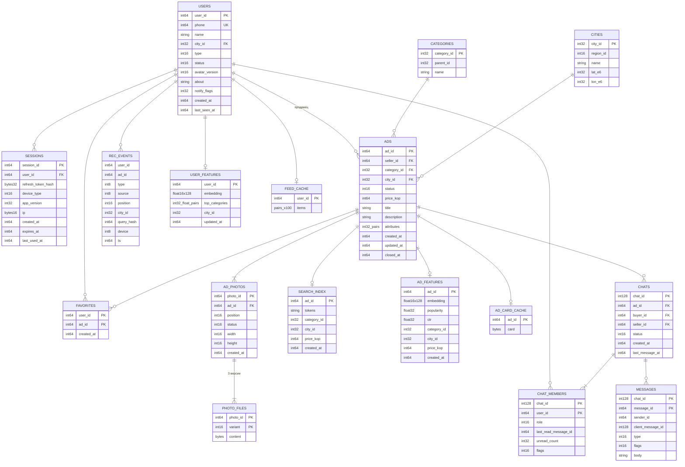
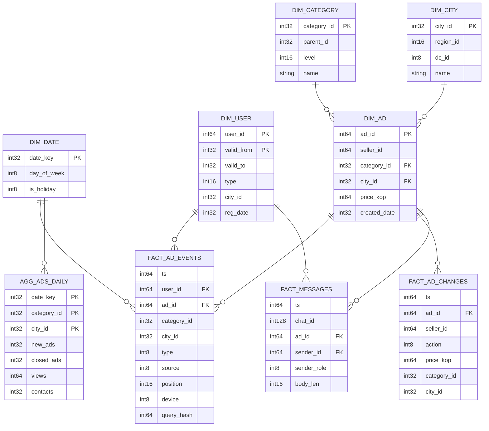
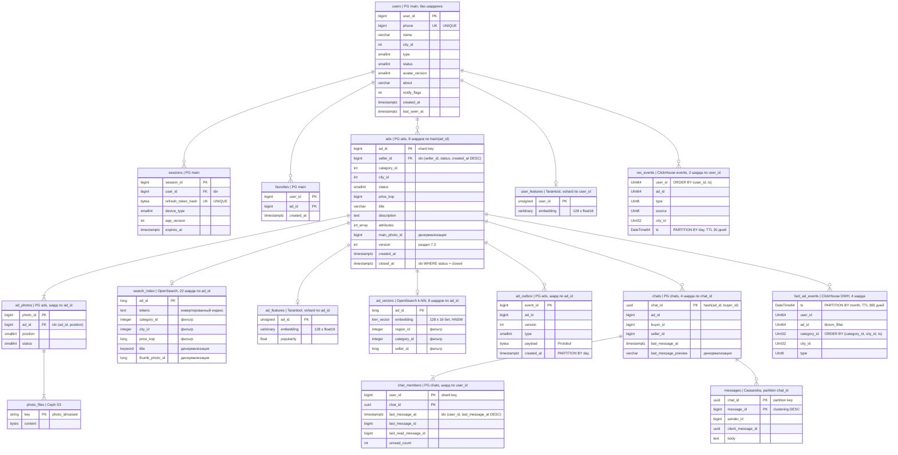

# Расчётно-пояснительная записка

**Дисциплина:** Проектирование высоконагруженных систем  
**Тема проекта:** Проектирование высоконагруженного сервиса онлайн-объявлений на примере «Авито»

## 1. Тема и целевая аудитория

### 1.1. Тема проекта, рыночная ниша и аналоги

Проектируется сервис онлайн-объявлений, в котором пользователи размещают предложения о продаже товаров, находят подходящие объявления и связываются с продавцами. Основной реальный аналог — **«Авито»**. Сервис поддерживает взаимодействие частных лиц между собой (C2C) и продажи от предпринимателей конечным покупателям (B2C).

Рыночная ниша - покупка и продажа новых и подержанных товаров через интернет. Покупатели сравнивают предложения по цене и местоположению, а продавцы получают доступ к массовой аудитории. Дополнительный аналог — платформы группы OLX, объединяющие частных пользователей и бизнес [2](https://www.olxgroup.com/about-us/).

В работе рассматривается основной пользовательский контур: объявления, поиск, рекомендательная лента, избранное и переписка. Большой каталог, хранение изображений, персонализация выдачи и обмен сообщениями делают архитектуру достаточно сложной для проектирования высоконагруженной системы.

### 1.2. Целевая аудитория: размер и локализация

Основной рынок — **Россия**. Целевая аудитория — частные покупатели и продавцы, предприниматели и небольшие магазины. Доступ осуществляется через сайт и мобильные приложения. Один пользователь может одновременно выступать покупателем и продавцом.

| Показатель | Значение | Основание |
| --- | --- | --- |
| Месячная аудитория реального аналога | **114 млн пользователей** | Внутренние данные AvitoTech [1](https://avito.tech/) |
| Активные объявления реального аналога | **220 млн** | Внутренние данные AvitoTech [1](https://avito.tech/) |
| MAU проекта | **114 млн** | Принятый масштаб на основе данных аналога |
| Средняя DAU проекта | **22,8 млн** | Расчётное допущение: 6 активных дней на пользователя за 30 дней |

DAU рассчитывается как **114 × 6 / 30 = 22,8 млн**. Это проектное допущение, а не опубликованная статистика «Авито». Полученное значение превышает требуемый минимум в 1 млн пользователей в день [3](https://github.com/init/highload/blob/main/homework_architecture.md).

### 1.3. Функционал MVP

Выделены **6 ключевых функций**:

1. **Регистрация и авторизация.** Создание аккаунта по номеру телефона, подтверждение входа и управление пользовательской сессией.
2. **Управление объявлениями.** Создание, редактирование и снятие с публикации, включая загрузку фотографий и подготовку уменьшенных версий. Объявление содержит название, описание, цену, категорию и город.
3. **Поиск и фильтрация.** Поиск по тексту, категории, цене и местоположению, сортировка, постраничная выдача и открытие карточки объявления.
4. **Рекомендательная лента.** Персональный подбор объявлений на главной странице по истории поиска, просмотрам, избранному и обращениям к продавцам с учётом местоположения пользователя.
5. **Избранное.** Сохранение объявлений в личный список и доступ к нему с разных устройств.
6. **Чат покупателя и продавца.** Обмен текстовыми сообщениями по объявлению, список диалогов, история переписки и отметки о прочтении.

Оплата, доставка, бронирование, платное продвижение, отзывы и видеоконтент в MVP не входят.

### 1.4. Ключевые продуктовые решения

- **Просмотр без входа.** Поиск и объявления доступны всем; публикация, избранное и чат требуют авторизации.
- **Асинхронное обновление поиска.** В выдачу попадают активные объявления, прошедшие базовую проверку. Изменения могут появляться с небольшой задержкой; при открытии карточки проверяется текущий статус.
- **Персонализация рекомендаций.** Сначала отбираются объявления-кандидаты по интересам и региону, затем модель ранжирует их по вероятности обращения к продавцу. События поведения обрабатываются асинхронно. Пользователям без истории и при недоступности рекомендаций показываются популярные и свежие объявления региона. Снятые объявления исключаются из выдачи.
- **Отдельное хранение фотографий.** База содержит метаданные изображений, а сами файлы размещаются в объектном хранилище.
- **Серверная история переписки.** Сообщения сохраняются при смене устройства. Повторная отправка запроса с тем же идентификатором не создаёт дубликат сообщения.

## 2. Расчёт нагрузки

### 2.1. Исходные продуктовые метрики

Масштаб аудитории и каталога взят из внутренних данных AvitoTech [1](https://avito.tech/), повторно проверенных 16.09.2026. Данные Similarweb не используются. **Частота действий, размеры объектов, сроки хранения и коэффициенты ниже — проектные допущения, а не статистика Авито.**

| Показатель | Значение | Основание |
| --- | --- | --- |
| MAU | 114 млн | Принятый в разделе 1 масштаб аналога [1](https://avito.tech/) |
| Средняя DAU | 22,8 млн | 114 млн × 6 активных дней / 30 дней |
| Хранимые аккаунты | 150 млн | Допущение, включая неактивные; число аккаунтов не равно MAU |
| Активные объявления | 220 млн | Масштаб каталога аналога [1](https://avito.tech/) |
| Создание объявлений | 0,05 на пользователя DAU в день | Например, одно новое объявление у 5% дневной аудитории |
| Фотографии в объявлении | В среднем 5 | Оригинал 2 МБ, версия для карточки 200 КБ, миниатюра 20 КБ |
| Выдача поиска / ленты | 20 карточек на страницу | В среднем загружаются 10 миниатюр; остальные — при прокрутке |
| Просмотр карточки | В среднем 3 фотографии | Передаётся версия 200 КБ, а не оригинал |
| Избранное | В среднем 10 записей на аккаунт | Одна загрузка списка передаёт 10 миниатюр |
| Снятые объявления и их фото | Хранятся 30 дней | Для модели принимается стабильный размер активного каталога |
| История чатов | Расчёт за 365 дней | При более долгом хранении объём растёт пропорционально сроку |
| События рекомендаций | 120 на пользователя DAU в день; хранение 30 дней | Около 100 показов и 20 других взаимодействий, включая поиск, просмотры и избранное |
| Коэффициент пика | **4** | Пиковый минутный RPS равен четырём среднесуточным; допущение для вечернего пика |

Все величины десятичные: **1 КБ = 1 000 Б; 1 ГБ = 10⁹ Б; 1 ТБ = 10¹² Б**. Дробные действия — среднее по всей DAU, включая пользователей, которые это действие не выполняют.

### 2.2. Действия пользователей и RPS

Одна загрузка страницы считается одним запросом. Фотографии и события аналитики учитываются отдельно. Адреса методов условные и описывают проектируемый API.

$$
N_i = DAU \times a_i,\qquad
RPS_{avg,i} = \frac{N_i}{86\,400},\qquad
RPS_{peak,i} = 4 \times RPS_{avg,i}.
$$

Например, поиск: **22,8 млн × 5 / 86 400 ≈ 1 319 запросов/с**, пик — **5 278 запросов/с**.

| Действие | Метод | На пользователя DAU в день | Млн запросов/сутки | Средний RPS | Пиковый RPS |
| --- | --- | ---: | ---: | ---: | ---: |
| SMS-код | `POST /auth/code` | 0,01 | 0,228 | 2,6 | 10,6 |
| Вход / регистрация | `POST /auth/verify` | 0,01 | 0,228 | 2,6 | 10,6 |
| Обновление сессии | `POST /auth/refresh` | 0,2 | 4,56 | 52,8 | 211,1 |
| Создание объявления | `POST /ads` | 0,05 | 1,14 | 13,2 | 52,8 |
| Редактирование / снятие | `PATCH /ads/{id}` | 0,1 | 2,28 | 26,4 | 105,6 |
| Поиск | `GET /search` | 5 | 114 | 1 319,4 | 5 277,8 |
| Рекомендательная лента | `GET /feed` | 5 | 114 | 1 319,4 | 5 277,8 |
| Карточка объявления | `GET /ads/{id}` | 10 | 228 | 2 638,9 | 10 555,6 |
| Список избранного | `GET /favorites` | 1 | 22,8 | 263,9 | 1 055,6 |
| Добавление в избранное | `PUT /favorites/{id}` | 0,25 | 5,7 | 66 | 263,9 |
| Удаление из избранного | `DELETE /favorites/{id}` | 0,25 | 5,7 | 66 | 263,9 |
| Создание диалога | `POST /chats` | 0,1 | 2,28 | 26,4 | 105,6 |
| Список диалогов | `GET /chats` | 1 | 22,8 | 263,9 | 1 055,6 |
| История сообщений | `GET /chats/{id}/messages` | 2 | 45,6 | 527,8 | 2 111,1 |
| Отправка сообщения | `POST /chats/{id}/messages` | 2 | 45,6 | 527,8 | 2 111,1 |
| Отметка о прочтении | `POST /chats/{id}/read` | 1 | 22,8 | 263,9 | 1 055,6 |
| События рекомендаций | `POST /events/batch` | 6 | 136,8 | 1 583,3 | 6 333,3 |
| **Итого API** | — | **33,97** | **774,516** | **8 964,3** | **35 857,2** |

В `PATCH /ads/{id}` заложены 0,05 редактирования текста/цены и 0,05 снятия с публикации на пользователя в день. Загрузка фото входит в создание объявления, но создаёт отдельные сетевые запросы:

| Действие | Метод | На пользователя DAU в день | Млн запросов/сутки | Средний RPS | Пиковый RPS |
| --- | --- | ---: | ---: | ---: | ---: |
| Загрузка фото | `PUT /media/{id}` | 0,25 | 5,7 | 66 | 263,9 |
| Миниатюры | `GET /media/{id}/thumb` | 110 | 2 508 | 29 027,8 | 116 111,1 |
| Фото в карточках | `GET /media/{id}/display` | 30 | 684 | 7 916,7 | 31 666,7 |
| **Итого изображения** | — | **140,25** | **3 197,7** | **37 010,4** | **148 041,7** |

Число загрузок фото: **0,05 × 5 = 0,25** на пользователя в день. Миниатюры: **(5 страниц поиска + 5 страниц ленты) × 10 + 10 из избранного = 110**. Крупные фото: **10 карточек × 3 = 30**. Это сетевые загрузки; эффект браузерного кэша для консервативной оценки не вычитается.

Совокупный внешний HTTP-пик — **183 899 запросов/с**, включая выдачу изображений через CDN. Это не RPS одного сервера или базы данных. Итоги рассчитаны до округления строк.

Для рекомендаций 120 событий передаются в среднем по 20 в пакете: **6 HTTP-запросов на пользователя в день**. Внутренняя обработка составляет **31 667 событий/с в среднем и 126 667 в пике**. Это события, а не дополнительные внешние запросы. При 500 кандидатах на запрос ленты верхняя оценка без кэширования — **2,64 млн оценок кандидатов/с**; стоимость одной оценки потребуется измерить при выборе модели.

### 2.3. Общий объём хранения

В сутки создаётся **22,8 млн × 0,05 = 1,14 млн объявлений**. При стабильном каталоге столько же снимается с публикации. Архив за 30 дней: **34,2 млн**; всего хранится **220 + 34,2 = 254,2 млн объявлений** и **1,271 млрд фотографий**. Это соответствует среднему активному сроку объявления около **193 дней**; допущение включает длительно размещённые предложения.

Формула: **V = количество объектов × средний размер объекта**. Для сообщений: **22,8 млн × 2 × 365 × 1 КБ = 16,644 ТБ**.

| Тип данных | Количество, млн шт. | Размер объекта | Объём, ТБ |
| --- | ---: | ---: | ---: |
| Профили и настройки | 150 | 2 КБ | 0,3 |
| Объявления и метаданные фото | 254,2 | 4 КБ | 1,017 |
| Оригиналы фото | 1 271 | 2 МБ | 2 542 |
| Фото для карточек | 1 271 | 200 КБ | 254,2 |
| Миниатюры | 1 271 | 20 КБ | 25,42 |
| Избранное | 1 500 | 32 Б | 0,048 |
| Сообщения | 16 644 | 1 КБ | 16,644 |
| Диалоги с участниками, 365 дней | 832,2 | 512 Б | 0,426 |
| **Итого** | — | — | **2 818,148** |

Размер объявления 4 КБ включает текст, атрибуты и метаданные фотографий; сами фото посчитаны отдельно. Сессии — две на пользователя MAU. Диалог 512 Б включает участников и служебные поля. Признаки — компактные данные для ранжирования. Кэш ленты содержит до 100 пар «объявление — оценка» по 16 Б для каждого пользователя DAU; хранение до суток. Поисковый индекс оценён отдельно по 6 КБ на активное объявление.

Это **одна копия данных**, без репликации, резервных копий и временных буферов. Для обычных записей также не включены накладные расходы СУБД и вторичные индексы. Физическую ёмкость уточняем при выборе хранилищ. На фотографии приходится **2 821,62 ТБ — около 98,7%** рассчитанного объёма.

Новые фото с производными версиями создают **12 654 ГБ записей в сутки**. В стабильном режиме столько же освобождается при удалении старого архива. Сообщения добавляют **45,6 ГБ/сутки**, события рекомендаций — **547,2 ГБ/сутки** с удалением записей старше 30 дней. Это запись в хранилища, а не повторно прибавляемый клиентский трафик.

### 2.4. Сетевой трафик

Размеры прикладных ответов: поиск, лента и история чата — **20 КБ**; избранное и список диалогов — **10 КБ**; карточка — **5 КБ**; вход и создание объявления — **2 КБ**; приём событий — **0,5 КБ**; остальные — **1 КБ**. Изображения в JSON не включаются.

На запрос закладывается **0,5 КБ**, кроме создания объявления (**3 КБ**), редактирования и отправки сообщения (**1 КБ**), пакета событий (**20 × 200 Б = 4 КБ**). Дополнительно учитывается одна онлайн-доставка получателю по **1 КБ** на отправленное сообщение. Получение истории уже включено в ответы API.

$$
V_{day,i}\,[ГБ] = \frac{N_i \times S_i\,[Б]}{10^9},\qquad
B_{peak,i}\,[Гбит/с] = \frac{V_{day,i}\,[ГБ] \times 8 \times 4}{86\,400}.
$$

| Тип трафика | Направление относительно сервиса | ГБ/сутки | Пик, Гбит/с |
| --- | --- | ---: | ---: |
| API: входящие запросы | Входящий | 892,85 | 0,331 |
| API: ответы | Исходящий | 7 228,28 | 2,677 |
| Фото: загрузка | Входящий | 11 400 | 4,222 |
| Миниатюры: выдача | Исходящий | 50 160 | 18,578 |
| Фото: выдача | Исходящий | 136 800 | 50,667 |
| Онлайн-доставка сообщений | Исходящий | 45,6 | 0,017 |
| **Всего входящий** | Клиент → сервис | **12 292,848** | **4,553** |
| **Всего исходящий** | Сервис → клиент | **194 233,884** | **71,938** |

Например, выдача крупных фото: **22,8 млн × 30 × 200 КБ = 136 800 ГБ/сутки**, пик — **50,667 Гбит/с**.

С **20% запасом** на транспортные накладные расходы и дополнительные передачи необходимая совокупная внешняя пропускная способность составляет **5,46 Гбит/с на вход и 86,33 Гбит/с на выход**. Направления считаются раздельно: это нагрузка всей системы, а не отдельного сетевого интерфейса.

При проектном допущении **90% попаданий в CDN-кэш** до основного хранилища доходит 10% чтений изображений. Для модели доля одинакова у обоих размеров фото, поэтому уменьшаются и запросы, и байты. С учётом API и доставки сообщений исходящий пик основных серверов составит **9,62 Гбит/с**, с запасом — **11,54 Гбит/с**. Это часть уже рассчитанного трафика, её не нужно прибавлять к нему второй раз. Межсерверный обмен и репликация оцениваются после выбора архитектуры.

Если частота активности составит 3–9 дней в месяц вместо 6, DAU изменится до **11,4–34,2 млн**, а запросы и клиентский трафик — до **0,5–1,5 базовой оценки**. Объём существующего каталога при этом не меняется автоматически; архив, сообщения и события пересчитываются по своим потокам и срокам хранения.

### 2.6. Рост нагрузки и ёмкости со временем

Для capacity planning введём отдельное **проектное допущение**: MAU и активный каталог растут на **10% в год**, а поведение одного пользователя, коэффициент пика и сроки хранения остаются неизменными. Это не прогноз для «Авито», а сценарий, позволяющий оценить запас инфраструктуры.

Для метрики, пропорциональной размеру аудитории или каталога:

$$
M(t) = M_0 \times (1 + g)^t,\qquad g = 0{,}10.
$$

При таких условиях RPS и сетевой трафик растут с тем же коэффициентом. Данные со скользящим TTL не накапливаются бесконечно: их объём после заполнения окна растёт главным образом вместе с DAU и каталогом.

| Горизонт | Коэффициент к текущей нагрузке | MAU, млн | DAU, млн | Пиковый API RPS | Совокупный внешний HTTP-пик, RPS | Хранилище, ТБ | Исходящий пик, Гбит/с | Исходящий пик +20%, Гбит/с |
| --- | ---: | ---: | ---: | ---: | ---: | ---: | ---: | ---: |
| Сейчас | 1,000 | 114,0 | 22,8 | 35 857 | 183 899 | 2 856,7 | 71,94 | 86,33 |
| Через 1 год | 1,100 | 125,4 | 25,08 | 39 443 | 202 289 | 3 142,3 | 79,13 | 94,96 |
| Через 2 года | 1,210 | 137,94 | 27,59 | 43 387 | 222 518 | 3 456,6 | 87,05 | 104,46 |
| Через 3 года | 1,331 | 151,73 | 30,35 | 47 726 | 244 769 | 3 802,2 | 95,75 | 114,91 |

Если реальный темп роста отличается от 10%, таблица пересчитывается заменой коэффициента `g`. Для архитектурного проектирования важен именно такой сценарный расчёт: он показывает, когда текущего запаса по RPS, сети и хранилищу перестанет хватать.

## 3. Глобальная балансировка нагрузки

### 3.1. Функциональное разбиение по доменам

Разные типы трафика имеют разные требования к кэшированию, состоянию соединений и отказоустойчивости, поэтому внешний трафик целесообразно разделить по поддоменам.

| Домен | Назначение | Основной тип нагрузки | Особенности балансировки |
| --- | --- | --- | --- |
| `www.service.ru` | Веб-клиент и статические ресурсы | Статика | CDN, агрессивное кэширование |
| `api.service.ru` | Авторизация, объявления, поиск, лента, избранное | Короткие HTTP-запросы | GSLB между ДЦ + локальный L7-балансировщик |
| `chat.service.ru` | Диалоги, сообщения, WebSocket | HTTP + долгоживущие соединения | Выбор ближайшего здорового ДЦ, соединение закрепляется до разрыва |
| `events.service.ru` | Пакетные события рекомендаций | Write-heavy HTTP | Можно сильнее перераспределять между ДЦ, так как обработка асинхронная |
| `media.service.ru` | Загрузка и выдача фотографий | Большой объём байтов и высокий RPS | CDN/Anycast; к origin идут загрузки и cache miss |

`www.service.ru` отдельно в расчёте RPS из раздела 2 не оценивался, поэтому для него не добавляется искусственная численная нагрузка. Основной динамический API из раздела 2 распределяется между `api`, `chat` и `events`, а изображения — через `media`.

### 3.2. Расположение дата-центров

Для проекта принимаются три независимых ДЦ:

1. **Москва** — основной ДЦ для западной части России и крупнейшей доли аудитории.
2. **Екатеринбург** — промежуточная точка для Поволжья и Урала, уменьшающая расстояние до центрального ДЦ для пользователей восточнее европейской части.
3. **Новосибирск** — ДЦ для Сибири и как ближайший из трёх регионов для значительной части трафика с востока страны.

Росстат публикует распределение населения по федеральным округам и субъектам [4]. Однако открытой статистики именно по географическому распределению трафика проектируемого сервиса в исходных данных нет, поэтому **не следует выдавать долю населения за долю запросов**. Для расчёта принимается явное проектное распределение трафика:

- Москва — **55%**;
- Екатеринбург — **25%**;
- Новосибирск — **20%**.

В production эти веса должны корректироваться по реальным данным о пользователях, сетевой задержке и загрузке ДЦ. Latency-based DNS routing позволяет направлять пользователя в регион с меньшей наблюдаемой задержкой, а health checks исключают недоступный endpoint [5].

Влияние размещения ДЦ на продуктовые метрики оценивается через технические показатели, которые напрямую измеряются в эксплуатации:

| Архитектурное решение | Измеряемая техническая метрика | Ожидаемое влияние на продукт |
| --- | --- | --- |
| Ближайший ДЦ для API | p50/p95 latency, TTFB | Более быстрые поиск, карточка и лента |
| Локальный вход для чатов | Время установки/восстановления соединения | Меньше задержка отправки сообщений и reconnect |
| CDN перед `media.service.ru` | Cache hit ratio, latency выдачи фото | Быстрее загрузка карточек и ленты |
| Несколько независимых ДЦ | Availability, error rate | Меньше недоступность сервиса при отказе региона |

Конкретный рост конверсии или retention без A/B-теста не задаётся: в работе фиксируется технический эффект, а не придумывается продуктовый uplift.

### 3.3. Распределение запросов по дата-центрам

В нормальном режиме для расчёта используются веса **55/25/20**. Для каждого типа запросов:

$$
RPS_{dc,i}=RPS_{peak,i}\times w_{dc}.
$$

Типы API объединены по функциональным группам; суммы получены из таблицы 2.2 до округления отдельных строк.

| Тип запросов | Общий пиковый RPS | Москва, 55% | Екатеринбург, 25% | Новосибирск, 20% |
| --- | ---: | ---: | ---: | ---: |
| Авторизация | 232,2 | 127,7 | 58,1 | 46,4 |
| Объявления и карточки | 10 713,9 | 5 892,6 | 2 678,5 | 2 142,8 |
| Поиск | 5 277,8 | 2 902,8 | 1 319,4 | 1 055,6 |
| Рекомендательная лента | 5 277,8 | 2 902,8 | 1 319,4 | 1 055,6 |
| Избранное | 1 583,3 | 870,8 | 395,8 | 316,7 |
| Чаты | 6 438,9 | 3 541,4 | 1 609,7 | 1 287,8 |
| События рекомендаций | 6 333,3 | 3 483,3 | 1 583,3 | 1 266,7 |
| **Итого API** | **35 857,2** | **19 721,5** | **8 964,3** | **7 171,4** |

Изображения нужно считать отдельно. Из **148 041,7 RPS** медиатрафика **263,9 RPS** приходится на загрузку фотографий, а **147 777,8 RPS** — на чтение миниатюр и фотографий. При принятом ранее cache hit ratio **90%** до origin доходит только 10% чтений:

$$
147\,777{,}8 \times 0{,}1 = 14\,777{,}8\ RPS.
$$

| Медиатрафик | Общий пиковый RPS | Москва, 55% | Екатеринбург, 25% | Новосибирск, 20% |
| --- | ---: | ---: | ---: | ---: |
| Загрузка фото в origin | 263,9 | 145,1 | 66,0 | 52,8 |
| Чтение изображений пользователями | 147 777,8 | 81 277,8 | 36 944,4 | 29 555,6 |
| Из них cache miss до origin, 10% | 14 777,8 | 8 127,8 | 3 694,4 | 2 955,6 |

Строка «чтение изображений пользователями» характеризует внешний трафик CDN и **не должна прибавляться** к нагрузке application-ДЦ. Пиковая нагрузка на origin в нормальном режиме составляет примерно:

$$
35\,857{,}2 + 263{,}9 + 14\,777{,}8 = 50\,898{,}9\ RPS.
$$

Из неё примерно **27 994 RPS** приходится на Москву, **12 725 RPS** на Екатеринбург и **10 180 RPS** на Новосибирск.

### 3.4. DNS-балансировка

Для динамических доменов используется DNS-GSLB с небольшим TTL и health checks. При здоровых ДЦ DNS выбирает endpoint по задержке/географии с целевыми весами 55/25/20. Если endpoint становится unhealthy, он исключается из ответов DNS. В документации Route 53 для latency records с health checks рекомендуется TTL 60 секунд или меньше, чтобы клиенты быстрее реагировали на изменение состояния [8].

```text
                         DNS GSLB
                    api.service.ru
                          |
            +-------------+-------------+
            |             |             |
      health/latency health/latency health/latency
            |             |             |
      VIP Москва      VIP Екатеринбург  VIP Новосибирск
          55%              25%              20%
            |               |                |
        Local L7 LB     Local L7 LB      Local L7 LB
            |               |                |
         API pool         API pool          API pool
```

DNS хорошо подходит для выбора региона, но failover не является мгновенным из-за TTL и кэшей резолверов. Поэтому быстрый входной failover и раздачу медиа целесообразно дополнять Anycast.

### 3.5. Anycast-балансировка

Для `media.service.ru` и внешнего edge-слоя используется единый Anycast IP. Один и тот же IP анонсируется из нескольких точек сети; BGP приводит пользователя к топологически ближайшему доступному edge. Такой подход типичен для CDN и глобальных edge-сетей [6].

```text
                         media.service.ru
                         Anycast IP
                              |
               +--------------+--------------+
               |              |              |
          Edge/PoP West   Edge/PoP Ural   Edge/PoP East
               |              |              |
          CDN cache       CDN cache       CDN cache
               | miss         | miss         | miss
               +--------------+--------------+
                              |
                     Regional origin layer
                 MSK 55% / EKB 25% / NSK 20%
```

При попадании в CDN-кэш запрос завершается на edge. Только cache miss идёт к origin. Поэтому Anycast снимает основную нагрузку с каналов между пользователями и ДЦ и уменьшает расстояние до точки выдачи фотографий.

### 3.6. Механизм регулировки трафика между ДЦ

Регулировка состоит из трёх уровней:

1. **Health checks.** Периодические проверки `/healthz` и ключевых зависимостей. Нездоровый ДЦ получает вес 0 и перестаёт принимать новый трафик. Health checks и автоматический failover являются стандартным механизмом глобальных балансировщиков [7].
2. **Latency/geo steering.** В штатном режиме пользователь направляется в ближайший здоровый ДЦ, но целевые веса ограничивают перекос нагрузки.
3. **Load-aware weights.** При приближении ДЦ к лимиту по RPS, CPU или latency его вес уменьшается постепенно, а новый трафик переносится в другие регионы. Для проектной модели порог начала разгрузки принимается на уровне около **80% выделенной ёмкости**.

Чтобы пережить отказ одного ДЦ, недостаточно распределить только текущую нагрузку: необходим резерв мощности. При origin-пике **50 898,9 RPS** предлагается capacity-план:

| ДЦ | Нормальная доля | Проектная ёмкость от общего origin-пика | Ёмкость, RPS |
| --- | ---: | ---: | ---: |
| Москва | 55% | 60% | 30 539 |
| Екатеринбург | 25% | 50% | 25 449 |
| Новосибирск | 20% | 50% | 25 449 |

Суммарно резервируется около **160%** нормальной пиковой мощности. Если Москва недоступна, Екатеринбург и Новосибирск могут временно принять примерно по 50% общей origin-нагрузки. Если выходит из строя один из меньших ДЦ, его трафик распределяется между Москвой и оставшимся регионом пропорционально свободной ёмкости.

Для чатов уже установленные WebSocket-соединения не мигрируют: при отказе они разрываются, клиент переподключается и через GSLB попадает в другой здоровый ДЦ. Для HTTP-запросов переключение происходит для новых запросов. Такой подход требует, чтобы сессия пользователя не зависела от памяти конкретного сервера, а состояние, необходимое между регионами, хранилось в реплицируемых сервисах данных.

## 4. Локальная балансировка нагрузки

Большая часть тяжёлого трафика сервиса — фотографии. Для них используется CDN: при принятом ранее cache hit **90%** большинство запросов к изображениям завершается на ближайшем CDN-узле и не доходит до наших дата-центров. Внутри ДЦ балансируется в основном API, чат, загрузка новых фотографий и cache miss от CDN.

Общая схема локальной балансировки:

```text
Пользователь / CDN
        |
        v
L3 — вход в дата-центр
        |
        v
L4 — балансировка TCP-соединений
        |
        v
L7 — HTTP/HTTPS балансировка
        |
        v
Backend-сервисы
```

### 4.1. L3 - вход в дата-центр

На этом уровне трафик приходит на **виртуальный IP-адрес (VIP)** дата-центра. Для отказоустойчивости используются два входных узла: основной и резервный.

Если основной узел недоступен, VIP переходит на резервный с помощью **VRRP**. Таким образом, внешний адрес дата-центра для клиентов не меняется.

Задача L3-уровня — обеспечить доступность самого входа в ДЦ и передать трафик дальше на L4-балансировщики.

**Резервирование:** `1 + 1`.

### 4.2. L4 - балансировка TCP

L4 работает на уровне TCP-соединений и распределяет новые соединения между L7-балансировщиками.

Для нашего сервиса этот уровень особенно нужен для:

- WebSocket-соединений чата;
- загрузки фотографий;
- обычных HTTPS-соединений к API.

Балансировка выполняется по соединениям, поэтому одно установленное TCP/WebSocket-соединение остаётся на одном выбранном узле до разрыва.

Используем **least connections**: новое соединение направляется на узел с меньшим количеством активных соединений.

Для каждого ДЦ достаточно двух L4-балансировщиков: один способен обработать расчётный сетевой поток ДЦ, второй нужен как резерв.

**Резервирование:** `N + 1`, в нашем случае `1 + 1`.

### 4.3. L7 - HTTP/HTTPS

На L7 используем **NGINX**. Здесь уже анализируется HTTP-запрос и определяется, в какой сервис его отправить.

NGINX выполняет:

- **SSL termination** - расшифровывает HTTPS;
- маршрутизацию по домену и пути, например `api.service.ru`, `chat.service.ru`, `/ads`, `/search`;
- health checks backend-сервисов;
- keep-alive и переиспользование соединений;
- поддержку WebSocket;
- rate limiting.

Пример:

```text
GET api.service.ru/search  -> search service
GET api.service.ru/ads/42  -> ads service
WS  chat.service.ru        -> chat service
```

### 4.4. Сколько L7-балансировщиков нужно

После CDN расчётный origin peak всей системы составляет около **50,9 тыс. RPS**. Самый нагруженный ДЦ с учётом резерва должен уметь принять около **60%**, то есть примерно **30,5 тыс. RPS**.

По официальным тестам NGINX на 4 CPU один узел способен обрабатывать значительно больше такого количества HTTPS-запросов, однако SSL termination и отказоустойчивость требуют запаса. Поэтому принимаем:

- **2 рабочих NGINX** на ДЦ;
- **1 резервный NGINX**;
- всего **3 NGINX на каждый ДЦ**.

Формула резервирования: **`N + 1`**.

При нормальной работе запросы распределяются между всеми узлами. При отказе одного оставшиеся продолжают обслуживать трафик.

### 4.5. Что происходит при отказе

- отказал входной L3-узел → VIP переходит на резервный по VRRP;
- отказал L4-балансировщик → новые TCP-соединения идут через оставшийся;
- отказал один NGINX → L4 перестаёт отправлять ему новые соединения;
- отказал backend → NGINX исключает его по health check;
- оборвался WebSocket → клиент подключается заново и может попасть на другой сервер.

Итоговая схема одного дата-центра:

```text
              VIP
               |
        +------+------+
        |             |
      L3-1          L3-2
        |             |
        +------+------+
               |
        +------+------+
        |             |
      L4-1          L4-2
        |             |
        +------+------+
               |
      +--------+--------+
      |        |        |
   NGINX-1  NGINX-2  NGINX-3
      |        |        |
      +--------+--------+
               |
         Backend-сервисы
```

Для медиа путь короче:

```text
Пользователь -> Anycast CDN -> cache hit: ответ сразу с CDN
                            -> cache miss / upload: выбранный ДЦ
```

## 5. Логическая схема БД

### 5.1. Схема

На схеме показаны все данные сервиса: основные таблицы, файлы фотографий, данные для поиска и рекомендаций и кэши. Всё, что можно, хранится числами (правила — в разделе 5.2). Конкретные СУБД и шардинг выбираются в разделе 6, аналитическое хранилище (DWH) описано в разделе 5.6.



Помимо таблиц на схеме, есть ещё три небольших хранилища:

- одноразовые SMS-коды (`phone` `int64`, хэш кода 32 Б, число попыток `int16`, живут 5 минут);
- таблица онлайн-соединений чата (`user_id` `int64` → `int32` номер узла, где открыт WebSocket);
- очереди: события рекомендаций, изменения объявлений (для обновления поиска и кэшей), доставка сообщений, обработка фото.

### 5.2. Описание таблиц

| Таблица | Что хранит |
| --- | --- |
| `USERS` | Профиль. Телефон уникален, по нему происходит вход |
| `SESSIONS` | Refresh-сессии устройств. Access-токен подписанный и короткий, поэтому таблица читается только при обновлении сессии |
| `CATEGORIES`, `CITIES` | Справочники, маленькие и почти не меняются |
| `ADS` | Объявления, основной источник данных каталога. Статус: на проверке, активно, снято |
| `AD_PHOTOS` | Метаданные фото и их порядок в объявлении |
| `PHOTO_FILES` | Сами файлы в объектном хранилище: оригинал, версия для карточки, миниатюра. Файлы не изменяются, новое фото получает новый ключ |
| `SEARCH_INDEX` | Документы для поиска по активным объявлениям, строятся из `ADS` |
| `FAVORITES` | Пары «пользователь — объявление» |
| `CHATS` | Диалог по объявлению. На пару «объявление — покупатель» один диалог |
| `CHAT_MEMBERS` | Для каждого участника: что прочитано и сколько непрочитанных. Отсюда строится список диалогов |
| `MESSAGES` | История сообщений. `client_message_id` защищает от дублей при повторной отправке |
| `REC_EVENTS` | Показы, клики, просмотры и т. п. для рекомендаций, хранятся 30 дней |
| `USER_FEATURES`, `AD_FEATURES` | Признаки для ранжирования, считаются из событий и объявлений |
| `FEED_CACHE` | Готовая лента: 100 пар (объявление, оценка) на пользователя, живёт до суток |
| `AD_CARD_CACHE` | Собранная карточка (объявление, фото, продавец) для популярных объявлений |

**Хранение в виде чисел.** Всё, что не является свободным текстом, хранится числами фиксированного размера:

| Что | Как хранится | Байт | Вместо |
| --- | --- | ---: | --- |
| Идентификаторы | `int64` (snowflake: время + узел + счётчик) | 8 | UUID-строки на 36 Б |
| `chat_id`, `client_message_id` | `int128` (два `int64`) | 16 | Строка на 32–36 Б |
| Телефон | `int64` в формате E.164: 79161234567 | 8 | Строка «+7 (916) 123-45-67», 18 Б |
| Цена | `int64` в копейках | 8 | `decimal` / `float` с ошибками округления |
| Статусы, типы, роли, варианты фото | `int16`/`int8`-коды из справочника в коде | 1–2 | Строки «active», «closed», 6–10 Б |
| Время | `int64`, миллисекунды Unix (в PostgreSQL — `timestamptz`, внутри тоже 8 Б) | 8 | Строка ISO 8601, 24 Б |
| Атрибуты объявления | Пары `(int32 attr_id, int32 value_id)` по справочнику категории, 15 пар | 120 | JSON «марка: Toyota, пробег: 120000», ~500 Б |
| Координаты города | `int32` градусы × 10⁶ | 4 + 4 | `float64` или строка |
| Версия приложения | `int32`: 4.12.3 → 41203 | 4 | Строка |
| Хэши токенов и кодов | Сырые 32 байта SHA-256 | 32 | Hex-строка на 64 Б |
| Настройки уведомлений | Битовая маска `int32` | 4 | Отдельные `bool`-поля или JSON |
| Эмбеддинги | 128 чисел `float16` | 256 | 128 × `float32` = 512 Б |
| Ключ файла фото | Строится из чисел: `photo_id/variant` | 10 | Строка-путь на ~60 Б |

Числа фиксированной длины занимают меньше места, быстрее сравниваются и индексируются, а в ClickHouse сжимаются в разы лучше строк. В строках остаются только имя, описание профиля, заголовок, описание объявления, текст сообщения и поисковые токены.

**Что хранится о пользователе (`USERS`):**

| Поле | Тип | Байт | Зачем |
| --- | --- | ---: | --- |
| `user_id` | `int64` | 8 | Идентификатор |
| `phone` | `int64`, уникальный | 8 | Вход по SMS, номер не показывается другим пользователям |
| `name` | строка до 64 символов, в среднем 20 символов кириллицы | 40 | Имя на карточке объявления и в чате |
| `city_id` | `int32` | 4 | Город по умолчанию для поиска и ленты |
| `type` | `int16`: 0 — частное лицо, 1 — компания | 2 | Пометка «компания» на карточке |
| `status` | `int16`: 0 — активен, 1 — заблокирован, 2 — удалён | 2 | Модерация и удаление аккаунта |
| `avatar_version` | `int16`, 0 — нет аватара | 2 | Ключ аватара в S3: `avatars/{user_id}/{version}`, ссылку хранить не нужно |
| `about` | строка до 500 символов, в среднем 50 символов | 100 | Описание профиля (в основном у компаний) |
| `notify_flags` | `int32`, битовая маска | 4 | Push, SMS, email; уведомления о сообщениях и избранном |
| `created_at` | `int64` | 8 | «На сервисе с …» |
| `last_seen_at` | `int64` | 8 | «Был в сети …» в чате |
| Служебное | заголовок строки PostgreSQL | 28 | |
| **Итого** | | **~214 → 256 Б** с выравниванием и запасом | |

Чего в `USERS` нет: паролей (вход только по SMS-коду), сессий (отдельная таблица), избранного и объявлений (свои таблицы со ссылкой на `user_id`), рейтинга и отзывов (не входят в MVP).

**Размеры записей остальных таблиц** (сумма полей + служебные данные хранилища: ~28 Б на строку PostgreSQL, ~40 Б в Tarantool, ~60 Б в Cassandra, в ClickHouse ~0):

| Таблица | Расчёт | Запись |
| --- | --- | ---: |
| `SESSIONS` | 8 + 8 + 32 + 2 + 4 + 16 + 3 × 8 + 28 | 122 → **128 Б** |
| `CATEGORIES`, `CITIES` | id, родитель или регион, название, координаты | ~100 Б |
| `ADS` | 8 + 8 + 4 + 4 + 2 + 8 + заголовок 80 (40 символов) + описание 3 200 (1 600 символов) + атрибуты 120 + 3 × 8 + 28 | 3 486 → **3,5 КБ** |
| `AD_PHOTOS` | 8 + 8 + 4 × 2 + 8 + 28 | 60 → **64 Б** |
| `PHOTO_FILES` | Оригинал / версия для карточки / миниатюра | 2 МБ / 200 КБ / 20 КБ |
| `SEARCH_INDEX` | Токены и инвертированный индекс + числовые поля фильтров | **6 КБ** |
| `FAVORITES` | 8 + 8 + 8 + 28 | 52 → **56 Б** |
| `CHATS` | 16 + 3 × 8 + 2 + 2 × 8 + 28 + превью последнего сообщения 200 (раздел 6.4) | 286 → **300 Б** |
| `CHAT_MEMBERS` | 16 + 8 + 2 + 8 + 4 + 2 + 28 + `last_message_at`, `last_message_id` 16 (раздел 6.4) | 84 → **88 Б** |
| `MESSAGES` | 16 + 8 + 8 + 16 + 2 + 2 + текст 400 (в среднем 200 символов) + 60 | 512 Б |
| `REC_EVENTS` | 8 + 8 + 1 + 1 + 2 + 4 + 8 + 1 + 8, ClickHouse хранит по столбцам без служебных полей | **41 Б** |
| `USER_FEATURES` | 8 + 256 + 20 категорий × (4 + 4) + 4 + 8 + 40 | 476 → **480 Б** |
| `AD_FEATURES` | 8 + 256 + 4 + 4 + 4 + 4 + 8 + 8 + 40 | 336 → **340 Б** |
| `FEED_CACHE` | 100 × (`ad_id` 8 + `float32` оценка 4 + `int16` причина 2 + `int16` флаги 2) | **1,6 КБ** |
| `AD_CARD_CACHE` | Карточка в MessagePack: объявление, 5 фото, имя продавца | **5 КБ** |

### 5.3. Размер данных и нагрузка

Количество записей взято из раздела 2.3, а размер записи посчитан по полям из раздела 5.2. В разделе 2.3 размеры были грубыми оценками с запасом. После перехода на числовые типы многие записи стали меньше: профиль — 256 Б вместо 2 КБ, сообщение — 512 Б вместо 1 КБ, событие — 41 Б вместо 200 Б. QPS посчитаны из таблицы RPS раздела 2.2 для пика, средний в 4 раза меньше. Если один запрос читает сразу много строк (например, 20 объявлений для страницы поиска), он считается как один запрос.

| Таблица | Записей | Размер записи | Объём | Чтение, QPS | Запись, QPS |
| --- | ---: | ---: | ---: | ---: | ---: |
| `USERS` | 150 млн | 256 Б | 38 ГБ | 11 600 | 11 |
| `SESSIONS` | 228 млн | 128 Б | 29 ГБ | 211 | 222 |
| `CATEGORIES`, `CITIES` | ~13 тыс. | — | ~20 МБ | в памяти сервисов | ~0 |
| `ADS` | 254 млн | 3,5 КБ | 890 ГБ | 23 300 | 158 |
| `AD_PHOTOS` | 1,27 млрд | 64 Б | 81 ГБ | 23 200 | 528 |
| `PHOTO_FILES` | 3,81 млрд | 2 МБ / 200 КБ / 20 КБ | 2 822 ТБ | 14 800 после CDN | 792 |
| `SEARCH_INDEX` | 220 млн | 6 КБ | 1,3 ТБ | 5 300 | 158 |
| `FAVORITES` | 1,5 млрд | 56 Б | 84 ГБ | 11 600 | 528 |
| `CHATS` | 832 млн | 300 Б | 250 ГБ | 5 400 | 2 200 |
| `CHAT_MEMBERS` | 1,66 млрд | 88 Б | 146 ГБ | 1 100 | 5 500 |
| `MESSAGES` | 16,6 млрд | 512 Б | 8,5 ТБ | 2 100 | 2 100 |
| `REC_EVENTS` | 82 млрд | 41 Б | 3,4 ТБ | только офлайн | 126 700 событий |
| `USER_FEATURES` | 114 млн | 480 Б | 55 ГБ | 1 100 | 3 200 |
| `AD_FEATURES` | 220 млн | 340 Б | 75 ГБ | 528 000 строк | 158 |
| `FEED_CACHE` | 22,8 млн | 1,6 КБ | 36 ГБ | 5 300 | 1 100 |
| `AD_CARD_CACHE` | 22 млн | 5 КБ | 110 ГБ | 23 200 | 2 500 |
| SMS-коды, онлайн-соединения | ~2,3 млн | 64–128 Б | < 1 ГБ | 3 200 | 6 300 |
| Очереди (хранение 3 суток) | — | — | ~0,65 ТБ | ~260 000 | ~132 000 |
| DWH (раздел 5.6), за год | ~1 трлн | в основном 45 Б | ~46 ТБ | десятки тяжёлых запросов/мин | ~127 000 событий пачками |
| **Итого** | | | **~2 880 ТБ** | | |

Откуда основные цифры:

- `ADS`: открытие карточки (10 556) + объявления для страниц поиска и ленты (10 556) + избранное и список диалогов (по 1 056). Запись — создание (53) и изменение/снятие (106).
- `FAVORITES`: список (1 056) + отметка «в избранном» на карточке (10 556).
- `CHAT_MEMBERS`: при отправке сообщения обновляются оба участника (2 × 2 111), плюс отметки о прочтении (1 056).
- `AD_FEATURES`: при пересчёте ленты ранжируется 500 кандидатов. Ленту пересчитываем только на первой странице (1 из 5), остальные страницы берутся из `FEED_CACHE`. Поэтому получается 1 056 × 500 ≈ 528 тыс. строк/с, а не 2,64 млн из раздела 2.
- `AD_CARD_CACHE`: в кэше 10% активных объявлений. Если попаданий 90%, в `ADS` уходит около 2 300 чтений в секунду.
- Очереди: событие в Protobuf с теми же числовыми полями занимает ~64 Б. За 3 суток это 2,74 млрд × 3 × 64 Б ≈ 0,53 ТБ, сообщения и изменения объявлений добавляют ещё ~0,12 ТБ.

Почти весь объём (98%) занимают фотографии. Без них остаётся около 61 ТБ: 46 ТБ — годовая история в DWH, 8,5 ТБ — сообщения, 3,4 ТБ — события за 30 дней. Все объёмы даны без сжатия и репликации. Часто читаемые данные (объявления, индекс, признаки, кэши, избранное) занимают всего несколько терабайт, поэтому в разделе 6 их можно держать в памяти.

### 5.4. Требования к консистентности

- **Пользователи, сессии, SMS-коды** — строгая. Нельзя завести два аккаунта на один номер, счётчик попыток ввода кода меняется атомарно.
- **Объявления и фото** — строгая при записи. Продавец сразу видит свои изменения. Поиск, признаки и кэш карточек обновляются асинхронно через очередь, задержка в несколько секунд допустима. При открытии карточки статус проверяется по `ADS`.
- **Избранное** — пользователь сразу видит изменения в своём списке. Повторное добавление ничего не ломает, так как пара уникальна.
- **Сообщения** — ответ клиенту отправляется только после записи. Внутри чата сохраняется порядок, дубли отсекаются по `client_message_id`. Отметка о прочтении только растёт, счётчик непрочитанных может немного отставать.
- **События, признаки, лента, кэши** — eventual. Потеря небольшой части событий не страшна, кэш можно построить заново.

### 5.5. Распределение нагрузки по ключам

- **Объявления.** Свежие и популярные объявления читают намного чаще остальных, поэтому нужны кэш карточек и CDN для фото. Запись по `ad_id` распределена равномерно.
- **Продавцы.** У магазинов бывают тысячи объявлений и много диалогов, поэтому `seller_id` как основной ключ даст горячие точки.
- **Город.** На Москву приходится больше половины трафика, поэтому разбивать данные только по `city_id` нельзя.
- **Сообщения.** Распределены по `chat_id` довольно равномерно. Почти всегда читается последняя страница недавних диалогов.
- **События.** Поток только на запись. По `user_id` их удобно агрегировать, по времени — удалять старые.
- **Фото.** Миниатюры новых объявлений горячие, оригиналы после обработки почти не читаются.
- **Время суток.** Вечером нагрузка в 4 раза выше средней, поэтому тяжёлые фоновые задачи (пересчёт популярности, обучение модели) запускаются ночью.

### 5.6. Аналитическое хранилище (DWH)

DWH нужен для отчётов продукта и бизнеса:
- сколько объявлений создано, продано и снято по категориям и городам;
- воронка «показ → просмотр карточки → сообщение продавцу»;
- эффективность поиска и ленты, результаты A/B-тестов;
- нагрузка на модерацию.

Такие запросы сканируют миллиарды строк за месяцы. Если запускать их в рабочих базах, они будут мешать пользователям. Кроме того, `REC_EVENTS` хранит только 30 дней, а аналитикам нужна история за год.

**Откуда берутся данные:**

- События показов, кликов и просмотров — тот же поток `rec-events`, но со своим потребителем и сроком хранения в год.
- Объявления, пользователи, диалоги — CDC (журнал изменений) из PostgreSQL через Kafka.
- Сообщения — только метаданные из `message-delivery`: кто, когда, по какому объявлению, длина текста. Тексты сообщений в DWH не попадают.

Персональных данных в DWH нет: ни телефонов, ни имён, ни текстов — только числовые идентификаторы. Это одна из причин хранить всё числами.

**Слои:** сырые данные (staging, 7 дней) → ядро (факты и измерения по схеме «звезда», 365 дней) → витрины (агрегаты по дням, хранятся бессрочно).



- **Факты** — неизменяемые записи о событиях, только числа: время `int64`, коды и идентификаторы. Ключ даты `YYYYMMDD` (`int32`) вычисляется из `ts` и связывает факт с `DIM_DATE`.
- **`DIM_USER` хранит историю изменений** (SCD2): если пользователь переехал или стал компанией, добавляется новая версия с `valid_from`. Так старые отчёты считаются по тому городу, в котором пользователь был тогда.
- **`category_id` и `city_id` продублированы в `FACT_AD_EVENTS`**, чтобы самые частые группировки не требовали соединения со справочником на миллиарды строк.

| Таблица | Записей за год | Запись | Объём |
| --- | ---: | ---: | ---: |
| `FACT_AD_EVENTS` | 2,74 млрд/сутки × 365 ≈ 1 трлн | 45 Б | ~45 ТБ |
| `FACT_MESSAGES` | 45,6 млн/сутки × 365 ≈ 16,6 млрд | 43 Б | ~0,7 ТБ |
| `FACT_AD_CHANGES` | 3,4 млн/сутки × 365 ≈ 1,25 млрд | 41 Б | ~0,05 ТБ |
| Измерения (`DIM_*`) | ~0,8 млрд с учётом версий | 26–36 Б | ~0,03 ТБ |
| Витрины (`AGG_*`) | ~1 млн/сутки | ~40 Б | ~0,015 ТБ |
| **Итого** | | | **~46 ТБ** до сжатия |

**Нагрузка.** Запись — те же ~127 тыс. событий/с в пике, но пачками по десяткам тысяч строк, плюс ~1 тыс. изменений/с из CDC. Чтение — десятки тяжёлых аналитических запросов в минуту и дашборды. Витрины пересчитываются ночью, когда нагрузка минимальна (раздел 5.5).

**Консистентность** — eventual. События доезжают за минуты, витрины считаются за прошедшие сутки. Небольшие потери или дубли событий на отчёты не влияют.

## 6. Физическая схема БД

### 6.1. Схема

В заголовке каждой таблицы указаны СУБД и ключ шардирования, у полей — типы конкретной СУБД, в комментариях к полям — индексы. Связи между разными хранилищами поддерживает приложение: внешних ключей между базами нет.



Кроме таблиц на схеме: кэши ленты и карточек, списки популярных и свежих объявлений для ленты, SMS-коды, онлайн-соединения и ключи дедупликации сообщений лежат в Redis, очереди — в Kafka. Изменения объявлений идут через Kafka в OpenSearch, Tarantool и Redis, события — в ClickHouse, а данные PostgreSQL попадают в DWH через CDC (Debezium).

### 6.2. Выбор СУБД

| Данные | СУБД | Почему |
| --- | --- | --- |
| `users`, `sessions`, `favorites`, справочники | PostgreSQL main | Транзакции и уникальность. ~0,25 ТБ, запись редкая — хватает одного мастера |
| `ads`, `ad_photos` | PostgreSQL, 8 шардов | Строгая запись, продавец сразу видит свои изменения. ~1,1 ТБ |
| `chats`, `chat_members` | PostgreSQL, 4 шарда | Уникальность диалога, 7,7 тыс. строк/с записи |
| `messages` | Cassandra | Только дописывание и чтение последней страницы, пишет в локальный ДЦ |
| Фото | Ceph (S3) | 2,8 ПБ неизменяемых файлов, раздача через CDN |
| `search_index`, `ad_vectors` | OpenSearch | Полнотекстовый поиск с фильтрами; k-NN (HNSW) для кандидатов ленты (раздел 7.1) |
| `rec_events` | ClickHouse | ~127 тыс. вставок/с пачками, удаление по TTL |
| DWH | ClickHouse, отдельный кластер | Отчёты по году истории, колоночное сжатие |
| `user_features`, `ad_features` | Tarantool | 528 тыс. чтений/с из памяти, WAL на диске |
| Кэши, SMS-коды, онлайн-соединения | Redis Cluster | Данные с TTL, потеря не критична |
| Очереди | Kafka | Несколько потребителей, порядок внутри ключа |

### 6.3. Индексы

Кроме первичных ключей:

- `users (phone)` UNIQUE — вход по номеру;
- `sessions (refresh_token_hash)` UNIQUE и `(user_id)` — обновление сессии и выход со всех устройств;
- `ads (seller_id, status, created_at DESC)` — «Мои объявления»; частичный `ads (closed_at) WHERE status = 'closed'` — удаление архива старше 30 дней;
- `ad_photos (ad_id, position)` — фото карточки по порядку;
- `chat_members (user_id, last_message_at DESC)` — список диалогов;
- `messages`: clustering key `message_id DESC` — последняя страница истории;
- `search_index` — инвертированный индекс по тексту и числовые фильтры;
- `ad_vectors` — HNSW-граф по эмбеддингам с фильтрами по региону и категории (раздел 7.1);
- ClickHouse: `rec_events ORDER BY (user_id, ts)`, `fact_ad_events ORDER BY (category_id, city_id, ts)`.

### 6.4. Денормализация

- `search_index` хранит `title`, `price_kop`, `city_id`, `thumb_photo_id` — выдача поиска без обращения к `ads`.
- `ads.main_photo_id` — миниатюра для ленты и избранного без `ad_photos`.
- `chats.last_message_preview` и `chat_members.last_message_at` — список диалогов без `messages`. Строки лежат на разных шардах, поэтому обновляются асинхронно из `message-delivery`, идемпотентно по `message_id`.
- `fact_ad_events.category_id`, `city_id` — отчёты без соединения с `dim_ad`.

Копии отстают на секунды, это допустимо по требованиям из раздела 5.4.

### 6.5. Шардирование и резервирование

| Данные | Шардирование | Резервирование |
| --- | --- | --- |
| PostgreSQL main | Нет | Мастер + синхронная реплика в Москве, асинхронные реплики в Екатеринбурге и Новосибирске |
| PostgreSQL ads | 8 шардов, `hash(ad_id)` через 256 бакетов | Так же для каждого шарда |
| PostgreSQL chats | 4 шарда: `chats` по `chat_id`, `chat_members` по `user_id` | Так же |
| Cassandra | По `chat_id` | RF = 3 в каждом ДЦ, `LOCAL_QUORUM` |
| Ceph | По ключу объекта | Оригиналы — EC 8+3 и копия во втором ДЦ, производные версии — 3 копии |
| OpenSearch | `search_index` — 22 шарда, `ad_vectors` — 8 шардов, по `ad_id` | 1 реплика, копия индекса в каждом ДЦ |
| ClickHouse events / DWH | 2 / 4 шарда по `user_id` | 2 реплики, Москва |
| Tarantool | vshard по `user_id` / `ad_id` | Мастер + реплика в каждом ДЦ |
| Redis | 16 шардов по слотам | Мастер + реплика в каждом ДЦ |
| Kafka | Партиции по ключу сообщения | RF = 3 |

- Бакеты нужны, чтобы добавить шард переносом бакетов, без перехэширования всех данных.
- `chat_id` — 128-битный хэш от `(ad_id, buyer_id)`, поэтому на пару приходится один диалог без глобального уникального индекса.
- По `seller_id` и `city_id` не шардируем из-за горячих ключей (раздел 5.5).

### 6.6. Клиентские библиотеки и подключения

Сервисы пишутся на Go.

- PostgreSQL — `pgx` + PgBouncer (transaction pooling, ~100 соединений на сервер), мастер определяет Patroni.
- Cassandra — `gocql` с token-aware и DC-aware политикой.
- Redis — `go-redis` cluster client; Tarantool — `go-tarantool` + vshard-router; Kafka — `franz-go`.
- ClickHouse — `clickhouse-go`, вставки пачками; аналитики ходят в DWH через chproxy.
- Ceph — фото загружаются клиентами по presigned URL; CDC в DWH — Debezium.

### 6.7. Резервное копирование

- PostgreSQL — WAL-G: полный бэкап раз в сутки + архив WAL, восстановление на любой момент за 14 дней.
- Cassandra — Medusa, 14 дней. ClickHouse — `clickhouse-backup`: события 7 дней, DWH 30 дней.
- Ceph — копия оригиналов во втором ДЦ. OpenSearch, Tarantool и Redis восстанавливаются из исходных данных.
- Бэкапы хранятся в Ceph в другом ДЦ, раз в месяц восстановление проверяется на тестовом стенде.

## 7. Алгоритмы

Описаны три блока, от реализации которых зависят хранилища, нагрузка и связи между сервисами: рекомендательная лента, отправка сообщений и обновление поиска после изменения объявления. Остальное (вход по SMS-коду, избранное, нарезка фото) делается стандартно. Изменения, к которым привели алгоритмы, уже внесены в раздел 6.

### 7.1. Рекомендательная лента: отбор кандидатов и ранжирование

**Где применяется:** `GET /feed`, сервис рекомендаций.

**Задача:** из 220 млн активных объявлений выбрать 100, по которым пользователь с наибольшей вероятностью напишет продавцу, и отдать первую страницу (20 карточек). Проектная цель — не больше 200 мс на сервере.

**Исходные данные и ограничения:**

- эмбеддинги пользователя и объявления (`user_features`, `ad_features`, 128 чисел по 16 бит). Их строит двухбашенная модель, обученная на `rec_events` за 30 дней: чем больше скалярное произведение векторов, тем интереснее объявление пользователю;
- город (через справочник — регион) и топ-20 категорий пользователя, популярность и CTR объявлений;
- в пике **1 056 пересчётов в секунду**: пересчитывается только первая страница, остальные 4 222 запроса `GET /feed` в секунду читают готовый список (раздел 5.3);
- собственные объявления пользователя в ленту не попадают, снятые убираются из выдачи;
- без истории или при отказе сервиса показываются популярные и свежие объявления региона (раздел 1.4).

**Алгоритм:**

1. **Отбор ~500 кандидатов**, три источника параллельно:
   - **300** ближайших к эмбеддингу пользователя — приближённый поиск ближайших соседей (ANN) в `ad_vectors` с фильтрами `region_id = регион пользователя` и `seller_id ≠ user_id`;
   - **150** популярных в регионе из топ-категорий пользователя — готовые списки `popular:{region_id}:{category_id}` в Redis;
   - **50** свежих, не старше суток, — список `fresh:{region_id}` в Redis.
2. **Удаление дублей** между источниками.
3. **Ранжирование.** Признаки кандидатов читаются из Tarantool одним пакетным запросом. К ним добавляются признаки пары: скалярное произведение эмбеддингов, вес категории у пользователя, расстояние между городами, отклонение цены от медианы категории, возраст объявления. Модель CatBoost [14] предсказывает вероятность обращения к продавцу.
4. **Разнообразие.** 100 объявлений набираются жадно по убыванию оценки, но на странице из 20 — не больше 2 от одного продавца и 6 из одной категории.
5. **Кэш.** 100 пар «объявление — оценка» записываются в `FEED_CACHE` (Redis, TTL сутки). Страницы 2–5 берутся оттуда. Карточки собираются из `AD_CARD_CACHE`, снятые за это время объявления пропускаются.

Фоновые процессы:

- эмбеддинг пользователя пересчитывается потребителем `rec-events` раз в минуту по последним 50 событиям — это ~3 200 записей/с в `user_features` из раздела 5.3;
- эмбеддинг объявления считается при создании и изменении (раздел 7.3);
- списки `popular:*` пересчитываются из ClickHouse каждые 15 минут, по 200 объявлений на пару «регион — категория»;
- раз в неделю ночью модель переобучается, все эмбеддинги пересчитываются, и рядом строится новый индекс `ad_vectors`. Переключение — заменой алиаса, без простоя.

**Структуры данных.** HNSW [10] — многоуровневый граф близости. Верхние уровни разрежены и позволяют быстро «перепрыгнуть» в нужную область, на нижнем каждый вектор связан с 2M ближайшими соседями. Поиск жадно спускается по уровням и просматривает тысячи векторов вместо 220 млн. Списки популярных и свежих объявлений — Redis sorted set с оценкой в качестве score.

**Параметры:**

| Параметр | Значение | Обоснование |
| --- | --- | --- |
| `M` / `ef_construction` / `ef_search` | 16 / 256 / 400 | `ef_search` не меньше числа запрашиваемых соседей (300). Полнота recall@300 ≥ 0,95 проверяется на выборке |
| Хранение векторов | 16 бит (`compression_level: 2x`, faiss) [12] | Индекс в 2 раза меньше, чем с `float32` |
| Фильтр по региону | Efficient filtering [13] | Для маленьких регионов OpenSearch сам переходит на точный перебор отфильтрованных векторов |
| Кандидатов | 500 | Компромисс полноты отбора и стоимости ранжирования |
| Длина кэша | 100 | 5 страниц по 20 — средняя глубина ленты из раздела 2.2 |

**Альтернативы:**

| Вариант | Почему не выбран |
| --- | --- |
| Ранжировать моделью все объявления региона | Даже в одном регионе миллионы объявлений, это в тысячи раз дороже 500 кандидатов |
| Точный перебор векторов вместо ANN | 220 млн × 256 Б = 56 ГБ чтения памяти на запрос, при 1 056 запросах/с — 59 ТБ/с |
| Строить ленты ночью для всех | 114 млн × 500 = 57 млрд оценок за ночь, а завтра зайдут только 22,8 млн. За день появляется 1,14 млн новых объявлений, и лента устаревает |
| Item-to-item («с этим также смотрят») | Нужна история взаимодействий объявления, новые объявления не получают показов |
| Только популярное в регионе | Нет персонализации. Оставлено для холодного старта и как fallback |

Выбранная двухэтапная схема (дешёвый отбор кандидатов + точное ранжирование небольшого набора) — стандартный подход крупных рекомендательных систем [11].

**Влияние на систему:**

- **Физическая схема:** добавлен индекс `ad_vectors` в OpenSearch: 220 млн × (256 Б вектор + 128 Б связи графа) ≈ **85 ГБ памяти на копию**. Списки `popular:*` и `fresh:*` в Redis занимают меньше 1 ГБ.
- **Нагрузка:** ANN — 1 056 запросов/с, с учётом 8 шардов ≈ **8,4 тыс. запросов к шардам в секунду**. Tarantool — 528 тыс. строк/с (раздел 5.3). Стоимость оценки, которую в разделе 2.2 нужно было уточнить: при допущении ~10 мкс CPU на кандидата (модель около 500 деревьев, уточняется замером) ранжирование занимает **~5,3 ядра** в пике, а без кэша ленты потребовалось бы ~26 ядер.
- **Взаимодействие:** лента синхронно ходит в OpenSearch, Redis и Tarantool. Асинхронно `rec-events` обновляют `user_features`, а `ad-changes` — `ad_features` и `ad_vectors`.

### 7.2. Отправка и доставка сообщений

**Где применяется:** `POST /chats/{id}/messages`, чат-сервис и WebSocket-шлюзы `chat.service.ru`.

**Задача:** сохранить сообщение ровно один раз, хотя клиент повторяет запрос при обрыве. Сохранить порядок внутри диалога и за доли секунды доставить сообщение на все устройства собеседника, а если он не в сети — отправить push.

**Исходные данные и ограничения:**

- в пике 2 111 отправок и 1 056 отметок о прочтении в секунду (раздел 2.2);
- ~2,3 млн одновременных WebSocket-соединений — 10% DAU, оценка из раздела 5.3;
- повтор запроса приходит с тем же `client_message_id`;
- клиенту отвечают только после записи (раздел 5.4);
- собеседники могут быть подключены к разным ДЦ.

**Алгоритм:**

1. Клиент генерирует `client_message_id` и отправляет сообщение.
2. Чат-сервис проверяет, что пользователь — участник диалога. Затем назначает `message_id` (snowflake: время в мс + номер узла + счётчик) и выполняет в Redis `SET dedup:{client_message_id} {message_id} NX EX 86400` [16].
3. Если ключ уже есть, это повтор: берётся сохранённый `message_id`, и запись повторяется с ним. `INSERT` в Cassandra с тем же первичным ключом перезаписывает ту же строку, поэтому дубля нет, даже если первая попытка упала до записи.
4. Сообщение записывается в Cassandra с `LOCAL_QUORUM` (2 из 3 реплик своего ДЦ), после чего клиент получает `message_id`.
5. Событие публикуется в Kafka `message-delivery` с ключом `chat_id`, поэтому сообщения одного диалога обрабатываются по порядку.
6. Потребитель доставки:
   - обновляет `chat_members` обоих участников (`unread_count + 1`, `last_message_at`) и превью в `chats` с условием `last_message_id < :message_id`. Повторная обработка ничего не меняет;
   - читает из Redis `online:{user_id}` — хэш «соединение → ДЦ и узел шлюза»;
   - отправляет сообщение по gRPC на нужные узлы шлюзов, в том числе в другом ДЦ, и те пишут его в WebSocket;
   - если ни одно устройство не в сети, отправляет push через FCM / APNs / RuStore, не чаще раза в минуту на диалог.
7. Клиент получателя отбрасывает повторы по `message_id` (доставка at-least-once) и вставляет сообщение по порядку `message_id`.
8. Прочтение: `last_read_message_id = max(текущее, новое)`, `unread_count = 0`. Значение только растёт, повтор безопасен.

**Структуры данных:** Redis-строка `dedup:*` с TTL, Redis-хэш `online:{user_id}`, партиция Cassandra `chat_id` с сортировкой `message_id DESC`, партиция Kafka по `chat_id`.

**Параметры:**

- TTL ключа дедупликации — 24 ч: клиент повторяет отправку минутами, запас большой. Если ключ потерян при failover Redis, возможен редкий дубль, это допустимо.
- Порядок по snowflake совпадает с порядком отправки с точностью до расхождения часов (NTP, единицы мс) — для переписки людей этого достаточно.
- `online:*` пишется при подключении с TTL 15 минут и продлевается раз в 10 минут: 2,3 млн / 600 с ≈ **3,8 тыс. записей/с**. Heartbeat каждые 30 с проверяется в памяти шлюза и в Redis не пишется.
- Один шлюз на Go держит ~100 тыс. соединений (допущение, ~20 КБ на соединение ≈ 2 ГБ памяти).

**Альтернативы:**

| Вариант | Почему не выбран |
| --- | --- |
| Опрос сервера раз в 5 с | 2,3 млн / 5 с = **460 тыс. RPS**, в 13 раз больше всего пикового API |
| Long polling | После каждого ответа и таймаута соединение открывается заново: ~77 тыс. лишних RPS при таймауте 30 с |
| Рассылка всем шлюзам (Redis Pub/Sub) | Каждый из ~40 шлюзов получает все 2 111 сообщений/с, из которых 97% чужие |
| Уникальность через Cassandra LWT (`IF NOT EXISTS`) | Задержка записи примерно в 4 раза выше из-за дополнительных обменов между репликами [15] |
| Сквозной счётчик сообщений в диалоге | Атомарный инкремент в PostgreSQL на каждое сообщение — лишняя транзакция на горячем пути |

**Влияние на систему:**

- **Физическая схема:** в Redis добавлены `dedup:*` (45,6 млн ключей в сутки × ~80 Б ≈ **3,6 ГБ**) и `online:*` (~0,25 ГБ).
- **Нагрузка на одно сообщение:** 1 запись в Redis, 1 в Cassandra, 1 в Kafka, 3 обновления строк в PostgreSQL chats, 1–2 чтения `online` и 1 вызов шлюза. В пике это ~2,1 тыс. записей/с в Cassandra и ~7,4 тыс. обновлений/с в PostgreSQL chats вместе с отметками о прочтении, что сходится с оценкой раздела 6.2.
- **Шлюзы:** 2,3 млн / 100 тыс. = 23 узла. С резервом на отказ ДЦ по долям 60/50/50 % из раздела 3.6 получается ~40 узлов (14 в Москве, 12 в Екатеринбурге, 12 в Новосибирске).
- **Между ДЦ:** Cassandra реплицирует сообщение в другие ДЦ асинхронно. Собеседник в другом регионе может на секунды не увидеть его в истории, но получит его через WebSocket сразу.

### 7.3. Обновление поиска и кэшей: transactional outbox

**Где применяется:** `POST /ads`, `PATCH /ads/{id}`, завершение модерации. Потребители — поиск, рекомендации, кэш карточек, DWH.

**Задача:** после изменения объявления в PostgreSQL обновить `search_index`, `ad_vectors`, `ad_features`, `AD_CARD_CACHE` и DWH так, чтобы ни одно изменение не потерялось, а старое не перезаписало более новое.

**Исходные данные и ограничения:** в пике 158 изменений/с (53 создания и 106 правок или снятий); новое объявление должно появиться в поиске за секунды (раздел 5.4); запись объявления не должна зависеть от доступности OpenSearch.

**Алгоритм:**

1. Сервис объявлений в одной транзакции меняет строку `ads` (`version = version + 1`) и вставляет событие в `ad_outbox`: `ad_id`, `version`, тип и снимок объявления в Protobuf вместе с главным фото [17].
2. Debezium читает WAL шарда через слот логической репликации и публикует событие в Kafka `ad-changes` с ключом `ad_id` [18]. Все изменения одного объявления попадают в одну партицию по порядку.
3. Каждый потребитель читает топик своей группой:
   - индексатор поиска отправляет bulk-запросы в OpenSearch раз в секунду или по 1 000 документов с `version_type=external`, так что документ с меньшей версией отбрасывается. Снятые объявления удаляются;
   - сервис признаков считает эмбеддинг и пишет его в `ad_features` и `ad_vectors`, снятые объявления удаляет;
   - инвалидатор выполняет `DEL card:{ad_id}` в Redis;
   - загрузчик DWH пишет в `fact_ad_changes`.
4. Offset в Kafka фиксируется только после записи. После сбоя событие обрабатывается повторно, и это безопасно благодаря версиям.
5. `ad_outbox` разбит на суточные партиции, партиции старше 3 дней удаляются целиком, без нагрузки от `DELETE`.

**Структуры данных:** таблица `ad_outbox` на каждом шарде PostgreSQL ads, топик `ad-changes` с хранением 3 дня, поле `version` в `ads` и во внешних индексах.

**Параметры:** задержка ≈ чтение WAL (< 1 с) + накопление bulk (≤ 1 с) + `refresh_interval` OpenSearch (1 с), то есть **1–3 с**. Трёх дней хранения в Kafka хватает, чтобы потребитель догнал поток после длительной аварии. Полная перестройка индекса делается из снапшота Debezium.

**Альтернативы:**

| Вариант | Почему не выбран |
| --- | --- |
| Сервис сам пишет в PostgreSQL, затем в Kafka | Падение между двумя записями: изменение потеряно или опубликовано событие о несохранённом объявлении |
| Синхронное обновление OpenSearch в запросе | Создание объявления тормозит и падает вместе с OpenSearch |
| Периодический опрос `ads` по `updated_at` | Запросы ко всем 8 шардам, удалённые строки не видны, задержка равна периоду опроса |
| CDC самой таблицы `ads` без outbox | Потребители зависят от внутренних колонок таблицы, а связанные данные (фото) пришлось бы дочитывать из PostgreSQL |

**Влияние на систему:**

- **Физическая схема:** поле `ads.version` и таблица `ad_outbox`. В среднем ~40 событий/с × 4 КБ × 3 суток ≈ **41 ГБ** на все шарды.
- **Нагрузка:** +158 вставок/с в PostgreSQL ads в пике, ~158 событий/с в Kafka и bulk в OpenSearch — немного по сравнению с остальным потоком. Используется тот же Debezium, что и для DWH (раздел 6.6).
- **Эксплуатация:** пока Debezium не прочитал WAL, слот репликации держит его на мастере. Отставание слота нужно мониторить, иначе при долгой остановке Debezium заполнится диск.

## 8. Технологии

| Технология | Область применения | Мотивация |
| --- | --- | --- |
| Go | Все backend-сервисы: API, чаты, лента, индексаторы, WebSocket-шлюзы | Компилируемый язык с дешёвыми горутинами: ~100 тыс. соединений на шлюз (раздел 7.2). Есть зрелые клиенты для всех выбранных хранилищ (раздел 6.6) |
| TypeScript, React, Next.js | Веб-клиент `www.service.ru` | Серверный рендеринг: карточки объявлений индексируются поисковиками. Собранная статика отдаётся через CDN |
| Kotlin, Swift | Мобильные приложения | Плавная прокрутка ленты с миниатюрами, нативные push-уведомления |
| REST/JSON, HTTP/2 | Внешний API | Понятен клиентам и легко кэшируется. HTTP/2 передаёт API-запросы и миниатюры по одному соединению |
| WebSocket | Доставка сообщений | Сервер сам отправляет сообщение, опрос дал бы 460 тыс. RPS (раздел 7.2) |
| gRPC, Protobuf | Вызовы между сервисами, события в Kafka | Бинарный формат и строгие схемы, числовые поля без накладных расходов JSON (раздел 5.2) |
| PowerDNS (LUA-записи) | DNS GSLB | Ответ по географии и с health checks (`ifurlup`, `pickclosest`), короткий TTL (раздел 3.4) [19] |
| BIRD (BGP) | Anycast для `media.service.ru` | Один IP анонсируется из всех PoP, при отказе PoP анонс снимается (раздел 3.5) |
| Keepalived (VRRP), IPVS | L3/L4 в каждом ДЦ | VIP переезжает на резервный узел за секунды. IPVS балансирует TCP в ядре Linux по least connections (раздел 4.2) |
| NGINX | L7 в ДЦ и кэш фото в PoP CDN | TLS termination, маршрутизация по доменам и путям, WebSocket, rate limiting, `proxy_cache` для фото (раздел 4.3) |
| PostgreSQL, Patroni, PgBouncer | Пользователи, объявления, диалоги, outbox | ACID и уникальность. Patroni через etcd автоматически переключает мастер [21], PgBouncer сводит тысячи клиентских соединений к ~100 серверным |
| Cassandra | История сообщений | Дописывание и чтение последней страницы по `chat_id`, запись в локальный ДЦ с `LOCAL_QUORUM` |
| Ceph RGW (S3) | Фотографии, бэкапы | 2,8 ПБ с горизонтальным ростом, erasure coding для оригиналов, presigned URL для загрузки |
| OpenSearch, k-NN | Полнотекстовый поиск, кандидаты для ленты | Инвертированный индекс с фильтрами и HNSW в одном кластере, отдельная векторная БД не нужна (раздел 7.1) |
| ClickHouse | События рекомендаций, DWH, логи | Колоночное сжатие, ~127 тыс. вставок/с пачками, TTL и партиции по дате |
| Tarantool, vshard | Признаки для ранжирования | 528 тыс. чтений/с из памяти, данные сохраняются на диск через WAL и снапшоты |
| Redis Cluster | Кэши ленты и карточек, SMS-коды, онлайн, дедупликация | Операции O(1) в памяти и TTL. Потеря данных не критична, всё восстанавливается |
| Kafka | Очереди событий и CDC | ~132 тыс. записей/с, порядок внутри ключа, повторное чтение, несколько групп потребителей |
| Debezium | Outbox и выгрузка в DWH | Читает WAL без дополнительных запросов к базе, есть Outbox Event Router (раздел 7.3) |
| libvips | Версии фото для карточки и миниатюры | Быстрее и экономнее по памяти, чем ImageMagick [20]: ~264 загрузки/с в пике × 2 версии |
| PyTorch | Обучение двухбашенной модели эмбеддингов | Стандартный инструмент для нейросетевых рекомендаций, обучение раз в неделю на GPU |
| CatBoost | Ранжирование кандидатов ленты | Градиентный бустинг на табличных признаках, быстрый инференс на CPU, C API для вызова из Go [14] |
| Apache Airflow | Ночные задачи: витрины DWH, популярность, обучение модели | Расписание, зависимости между шагами, перезапуск упавших шагов |
| Kubernetes | Stateless-сервисы и шлюзы | Автомасштабирование под вечерний пик ×4, плавный деплой. Базы данных работают на выделенных серверах |
| GitLab CI, Argo CD | Сборка и деплой | Состояние кластера описано в git, откат — возврат коммита |
| Prometheus, VictoriaMetrics, Grafana | Метрики и алерты | Latency, ошибки, отставание Kafka и слотов репликации. VictoriaMetrics хранит метрики долго |
| Vector | Сбор логов в ClickHouse | Лёгкий агент, пишет в ClickHouse пачками |
| OpenTelemetry, Jaeger | Трассировка запросов | Запрос ленты проходит через 4–5 хранилищ, трассировка показывает, где теряется время |
| HashiCorp Vault | Секреты | Пароли БД, ключи S3, ключ подписи access-токенов |
| SMS-шлюз, FCM / APNs / RuStore Push | Коды входа, push-уведомления | Внешние провайдеры доставки |

## Список источников

1. **AvitoTech.** Официальный сайт, блок «AvitoTech в цифрах»: аудитория и активные объявления. [avito.tech](https://avito.tech/).
2. **OLX Group. About us.** Описание платформ и рыночной ниши. [olxgroup.com/about-us](https://www.olxgroup.com/about-us/).
3. **Задание по проектированию высоконагруженных систем.** [GitHub](https://github.com/init/highload/blob/main/homework_architecture.md).
4. **Росстат. Регионы России. Основные характеристики субъектов Российской Федерации, 2025.** [rosstat.gov.ru](https://rosstat.gov.ru/storage/mediabank/Region_Subekt_2025.htm).
5. **Amazon Route 53. Latency-based routing.** Выбор региона по задержке и health checks. [docs.aws.amazon.com](https://docs.aws.amazon.com/Route53/latest/DeveloperGuide/routing-policy-latency.html).
6. **Cloudflare. Load Balancing Reference Architecture.** Anycast и глобальный edge. [developers.cloudflare.com](https://developers.cloudflare.com/reference-architecture/architectures/load-balancing/).
7. **Cloudflare. Health checks and endpoint health.** Контроль доступности и исключение нездоровых endpoint. [developers.cloudflare.com](https://developers.cloudflare.com/load-balancing/understand-basics/health-details/).
8. **Amazon Route 53. Values specific for latency records.** Рекомендации по TTL и привязке health check. [docs.aws.amazon.com](https://docs.aws.amazon.com/Route53/latest/DeveloperGuide/resource-record-sets-values-latency.html).
9. **NGINX. Testing the Performance of NGINX Ingress Controller for Kubernetes.** Результаты тестов HTTPS RPS, SSL/TLS TPS и throughput для расчёта локального L7-слоя. [blog.nginx.org](https://blog.nginx.org/blog/testing-performance-nginx-ingress-controller-kubernetes).
10. **Malkov Yu. A., Yashunin D. A.** Efficient and robust approximate nearest neighbor search using Hierarchical Navigable Small World graphs. [arXiv:1603.09320](https://arxiv.org/abs/1603.09320).
11. **Covington P., Adams J., Sargin E.** Deep Neural Networks for YouTube Recommendations. RecSys 2016. Двухэтапная схема «отбор кандидатов + ранжирование». [doi:10.1145/2959100.2959190](https://doi.org/10.1145/2959100.2959190).
12. **OpenSearch. Memory-optimized vectors.** 16-битное хранение векторов в движке faiss. [docs.opensearch.org](https://docs.opensearch.org/latest/mappings/supported-field-types/knn-memory-optimized/).
13. **OpenSearch. Efficient k-NN filtering.** Фильтрация при ANN-поиске и переход на точный перебор. [docs.opensearch.org](https://docs.opensearch.org/latest/vector-search/filter-search-knn/efficient-knn-filtering/).
14. **CatBoost.** Документация. [catboost.ai](https://catboost.ai/docs/en/).
15. **DataStax. Using lightweight transactions.** Задержка LWT в Cassandra. [docs.datastax.com](https://docs.datastax.com/en/cql-oss/3.3/cql/cql_using/useInsertLWT.html).
16. **Redis. SET command.** Опции `NX` и `EX`. [redis.io](https://redis.io/docs/latest/commands/set/).
17. **Richardson C. Pattern: Transactional outbox.** [microservices.io](https://microservices.io/patterns/data/transactional-outbox.html).
18. **Debezium. Outbox Event Router.** [debezium.io](https://debezium.io/documentation/reference/stable/transformations/outbox-event-router.html).
19. **PowerDNS. LUA Records.** Health checks и выбор ближайшего адреса в DNS. [doc.powerdns.com](https://doc.powerdns.com/authoritative/lua-records/).
20. **libvips. Speed and memory use.** Сравнение с ImageMagick и другими библиотеками. [github.com/libvips](https://github.com/libvips/libvips/wiki/Speed-and-memory-use).
21. **Patroni.** Документация: автоматический failover PostgreSQL. [patroni.readthedocs.io](https://patroni.readthedocs.io/en/latest/).
